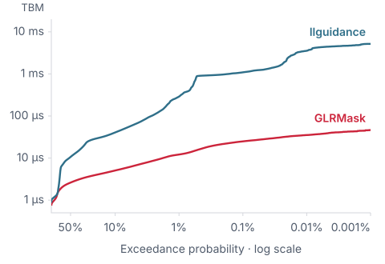
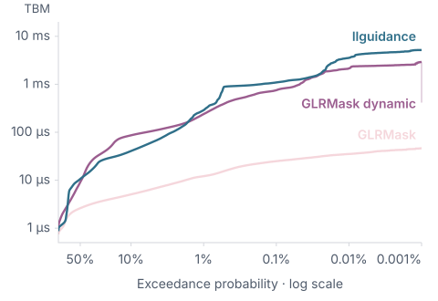

<!-- Generated by scripts/sync-guide.py from docs/content. Do not edit this output. -->

GLRMask is a grammar-constrained decoding library for high-throughput LLM serving. It is optimized for fast mask computation with extremely low tail latency, even for complex grammars.

GLRMask supports general context-free grammars, including ambiguous ones. It accepts GLRM (its native grammar format), JSON Schema, and Lark.

[Website](https://glrmask.com) · [Paper](https://doi.org/10.5281/zenodo.23273556)

## Benchmarks

### JSON Schema

Time between masks. Lower is better.

<p align="center">
<picture>
  <source media="(prefers-color-scheme: dark)" srcset="docs/assets/benchmark-tbm-json-2026-10-14-dark.svg">
  
</picture>
</p>

**TBM (µs)**

| Statistic | Static / FastRuntime | Dynamic / FastBuild | Balanced / O2 | llguidance |
|---|---:|---:|---:|---:|
| Mean | 3.0 | 31.5 | 12.7 | 25.9 |
| p50 | 2.6 | 9.1 | 6.9 | 10.6 |
| p90 | 5.1 | 86.4 | 30.3 | 40.7 |
| p99 | 12.2 | 239.5 | 74.8 | 289.9 |
| p99.9 | 24.9 | 754.2 | 206.1 | 1,092.6 |
| Max | 283.1 | 3,647.8 | 2,140.9 | 6,931.5 |

**Time to first mask (ms)**

| Statistic | Static / FastRuntime | Dynamic / FastBuild | Balanced / O2 | llguidance |
|---|---:|---:|---:|---:|
| Mean | 33.7 | 3.9 | 12.3 | 1.2 |
| p50 | 12.6 | 2.3 | 6.2 | 0.8 |
| p90 | 78.9 | 6.5 | 19.0 | 1.8 |
| p99 | 302.3 | 35.9 | 125.5 | 11.1 |
| p99.9 | 854.3 | 88.8 | 445.0 | 17.9 |
| Max | 1,293.4 | 274.6 | 631.1 | 231.0 |

14 October 2026 · 11,277 complete valid trajectories accepted by all four engines · 1,734,930 TBM positions per engine · 8,326 common-built cases for TTFM. One unpinned native wall-clock timing run on AWS c8i.8xlarge (Intel Xeon 6975P-C, 32 available CPUs). Vocabulary preparation is excluded.

### JavaScript

Time between masks. Lower is better.

<p align="center">
<picture>
  <source media="(prefers-color-scheme: dark)" srcset="docs/assets/benchmark-tbm-javascript-2026-10-14-dark.svg?v=5274bdb45744">
  
</picture>
</p>

**TBM (µs)**

| Statistic | Static / FastRuntime | Dynamic / FastBuild | Balanced / O2 | llguidance |
|---|---:|---:|---:|---:|
| Mean | 16.9 | 1,392.4 | 389.0 | 1,052.2 |
| p50 | 18.2 | 145.5 | 69.9 | 856.6 |
| p90 | 30.4 | 3,626.1 | 1,088.8 | 2,521.7 |
| p99 | 47.9 | 4,091.7 | 1,509.6 | 3,097.0 |
| p99.9 | 71.1 | 4,656.9 | 2,016.8 | 3,597.1 |
| Max | 77.4 | 5,517.4 | 2,139.0 | 3,867.9 |

**Time to first mask (ms)**

| Statistic | Static / FastRuntime | Dynamic / FastBuild | Balanced / O2 | llguidance |
|---|---:|---:|---:|---:|
| Mean | 5,089.4 | 113.3 | 458.4 | 8.0 |
| p50 | 5,099.6 | 113.0 | 457.8 | 8.0 |
| p90 | 5,152.7 | 116.9 | 464.3 | 8.1 |
| p99 | 5,223.0 | 120.7 | 470.4 | 8.2 |
| p99.9 | 5,225.9 | 121.7 | 472.3 | 8.2 |
| Max | 5,226.2 | 121.8 | 472.5 | 8.2 |

14 October 2026 · 28 complete valid trajectories accepted by all four engines · 3,805 TBM positions per engine · 55 common-built cases for TTFM. One unpinned native wall-clock timing run on AWS c8i.8xlarge (Intel Xeon 6975P-C, 32 available CPUs). Vocabulary preparation is excluded.

#### Dynamic mode

GLRMask’s dynamic mode trades some mask-generation speed for lower cold-start latency. It is heavily based on [llguidance](https://github.com/guidance-ai/llguidance).

<p align="center">
<picture>
  <source media="(prefers-color-scheme: dark)" srcset="docs/assets/benchmark-tbm-json-dynamic-2026-10-14-dark.svg">
  
</picture>
</p>

[Explore Dynamic JSON results](https://glrmask.com/?dataset=json&mode=dynamic#benchmarks).

There was no CPU pinning or SMT sibling reservation, and checkpoint publication overlapped the benchmark. Saved telemetry cannot isolate scheduling effects; latency stabilization is not certified. Successful builds do not establish semantic correctness. All 9,558 JSON schemas were attempted: build errors are Dynamic 232, Balanced 232, Static 233 and llguidance 1,226. Incorrect examples are 460 for each GLRMask mode and 100 for llguidance; runtime-error examples are 0 and 6 respectively. JavaScript attempts all 55 fixtures: all builds succeed, with 1 incorrect example per GLRMask mode and 4 for llguidance. Headline TBM excludes incomplete or nonaccepted valid trajectories; all outcomes remain in the raw records. This finite corpus does not establish full-language equivalence or whole-corpus dominance.

[Native AWS benchmark details](docs/benchmark-aws-2026-10-14.md). Historical [October 8 Mac JSON](docs/benchmark-cfa-2026-10-08.md) and [October 9 Mac JavaScript](docs/benchmark-javascript-2026-10-09.md) reports are retained with their original measurement protocols. These are source builds, not measurements of the published 0.2 packages.

## Installation

### Python

```bash
python -m pip install glrmask
```

### Rust

```bash
cargo add glrmask
```

### Native C++ and Node.js

Native bindings are available for C++ and JavaScript/TypeScript on Node.js. The [C++ guide and C API](https://glrmask.com/api/cpp/) and [JavaScript and TypeScript guide](https://glrmask.com/api/javascript/) cover source builds, platform artifacts, ownership, composition, and the complete supported API. The Node.js addon runs the Rust engine directly; browser WebAssembly is a separate target.

## Usage

GLRMask has four core types:

- `Grammar`: the language you want to generate.
- `PreparedGrammar`: vocabulary-specific reusable machinery, which can still have unresolved bindings.
- `Constraint`: a grammar compiled against a specific vocabulary.
- `ConstraintState`: the mutable state for a single generated sequence.

### Python quickstart

```python
import glrmask

vocab = glrmask.Vocab.from_id_to_bytes({0: b"hello", 1: b" ", 2: b"world"})
grammar = glrmask.Grammar.from_ebnf('start ::= "hello" " " "world"')
constraint = grammar.compile(vocab)
state = constraint.start()
for token_id, expected in [(0, [True, False, False]),
                           (1, [False, True, False]),
                           (2, [False, False, True])]:
    assert state.mask().tolist() == expected
    state.commit_token(token_id)
assert state.is_accepting()
```

Python masks are NumPy Boolean arrays indexed by original model token ID.

The next compatibility release targets ordinary, GIL-enabled CPython 3.9
through 3.15. Its `cp39-abi3` wheels use Python's stable extension ABI, so one
wheel per operating-system/architecture combination can serve multiple Python
versions. This does not imply support for free-threaded Python (`cp314t`,
`cp315t` or `abi3t`): the extension explicitly retains the GIL requirement.

The expanded build matrix covers Windows x64/ARM64, macOS Intel/Apple Silicon,
and Linux x64/ARM64 with either glibc or musl. Linux glibc Python wheels retain
the manylinux2014 baseline; native C++/Node binaries use glibc 2.28 or newer.
See [the compatibility guide](https://github.com/IsaacBreen/glrmask/blob/main/docs/compatibility.md)
for runtime requirements and the distinction between source support and
published package availability.

### Rust quickstart

```rust
use glrmask::{Grammar, Vocab};

fn main() -> glrmask::Result<()> {
    let vocab = Vocab::new(vec![
        (0, b"hello".to_vec()), (1, b" ".to_vec()), (2, b"world".to_vec()),
    ]);
    let grammar = Grammar::from_ebnf(r#"start ::= "hello" " " "world""#);
    let constraint = grammar.compile(&vocab)?;
    let mut state = constraint.start();
    for (token_id, expected) in [(0, 1), (1, 2), (2, 4)] {
        assert_eq!(state.mask()[0] & 7, expected);
        state.commit_token(token_id)?;
    }
    assert!(state.is_accepting());
    Ok(())
}
```

Rust masks are packed `u32` bitsets. Bit `token_id % 32` of word `token_id / 32` indicates whether that token is allowed.

### Isolated components and typed bindings

GLRM distinguishes two external contracts. `extern token NAME` consumes one exact
model-token event from a bound ID set. `extern grammar NAME` invokes a separately
scoped grammar, which can contain bytes, exact events, or epsilon. Binding a value
of the wrong kind is an error; an exact ID is never replaced by its decoded text.

```rust
use glrmask::{Grammar, Result, Vocab};

# fn demo(vocab: &Vocab, end_id: u32) -> Result<()> {
let mut parent = Grammar::from_glrm(r#"
    extern grammar PAYLOAD
    extern token END
    start response
    nt response = PAYLOAD END
"#);
let child = Grammar::from_json_schema(r#"{"type":"null"}"#);
parent.bind("PAYLOAD", &child)?;
parent.bind("END", glrmask::Token::new(end_id))?;
let constraint = parent.compile(vocab)?;
# let _ = constraint;
# Ok(())
# }
```

Use `vocab.tokens(ids)` or `vocab.token_ranges(ranges)` for exact sets. Rust ranges
are inclusive; Python `range` stops are exclusive. The set consumes **one** ID,
not a sequence. Sparse vocabulary holes and incompatible vocabulary identities
are errors. IDs with the same spelling remain distinct, and spelling-less IDs
are not epsilon. See [exact-token ranges](docs/exact-token-ranges.md).

A grammar-valued parameter also accepts `Token` or `ExactTokens` directly: this
widens an exact event into a general fragment without changing its meaning.
`Grammar::exact(vocab.tokens([id])?)` (Rust) and
`glrmask.Grammar.exact(vocab.tokens([id]))` (Python) remain available for creating
a standalone event-aware grammar. Neither conversion uses decoded token spelling.
An arbitrary grammar cannot bind a token-valued parameter.

### Prepare, attach, specialize, link

`Grammar.prepare(vocab)` creates a non-runnable `PreparedGrammar`. The parent and
its children may both have unresolved parameters. `bind(name, value)` mutates the
receiving assembly handle and returns `Result<()>` in Rust or `None` in Python.
Each successful bind publishes a new shared snapshot; an error leaves the previous
configuration intact. Attaching a child captures its current configuration, not
a live reference to later edits. Use `clone()` to specialize independently:

```python
import glrmask

vocab = glrmask.Vocab.from_id_to_bytes({
    0: b"x", 1: b"|", 2: b"x", 4: b"", 5: b"",
})
leaf = glrmask.Grammar.from_glrm('''
    extern token MARK
    start body
    nt body = "x" MARK
''').prepare(vocab)
parent = glrmask.Grammar.from_glrm('''
    extern grammar LEFT
    extern grammar RIGHT
    start pair
    nt pair = LEFT "|" RIGHT
''').prepare(vocab)

package = parent.clone()
package.bind("LEFT", leaf)
package.bind("RIGHT", leaf)
assert [r.name for r in package.requirements] == ["LEFT::MARK", "RIGHT::MARK"]
complete = package.clone()
complete.bind("LEFT::MARK", vocab.tokens([4]))
complete.bind("RIGHT::MARK", vocab.tokens([5]))
constraint = complete.link()
state = constraint.start()
for token_id in [0, 4, 1, 2, 5]:
    assert state.mask()[token_id]
    state.commit_token(token_id)
assert state.is_accepting()
assert [r.name for r in leaf.requirements] == ["MARK"]
```

Rust uses the same operations: `prepare(&vocab)?`, `bind(name, &child)?`, and
`link()?` or `link_with(options)?`. Source `Grammar` objects also support open
attachment and later `CHILD::PARAM` binding. A descendant can be bound only after
its attachment exists. Unknown names and attempts to rebind a filled parameter
are rejected.

Each inline `grammar NAME { ... }` has an isolated interface, start rule, terminals,
and ignore policy. It does not inherit enclosing externs. Two references to the
same named inline grammar share that definition's bindings. Attaching the same
prepared child at two different names creates independently bindable occurrences.

`requirements()` in Rust, or `.requirements` in Python, reports structured paths,
expected kinds, and available original source spans. Preparation is allowed while
requirements remain; final `compile()` or `link()` requires every declared
parameter to be bound, including declarations whose uses are unreachable.
Introspection has finite traversal limits rather than expanding arbitrary shared
graphs without a bound.

### Persistence and root policy

Prepared components can be saved while incomplete:

```python
saved = package.save()
restored = glrmask.PreparedGrammar.load(saved, vocab=vocab)
assert [r.name for r in restored.requirements] == ["LEFT::MARK", "RIGHT::MARK"]
```

Runnable constraints separately support `save()` and `Constraint.load(...)`.
Artifacts preserve original token coordinates and vocabulary identity, not merely
a set of decoded spellings. Unsupported older pre-release formats are rejected.
Prepared artifacts are vocabulary-specific, not portable across arbitrary models.

Configure `end_tokens` on the final compile or link operation. Acceptance means a
complete grammar match exists; it does not require generation to stop when longer
matches remain possible. A configured end ID is admitted only at acceptance. Commit
the sampled end ID before ending the generation loop. Child components do not
supply the enclosing generation's root termination policy.

### Determined output

`state.forced_tokens()` returns a read-only library-canonical prefix for genuinely
forced ordinary text. It greedily chooses the longest admitted nonempty spelling,
then the lowest original-ID alias. Exact-token events retain their IDs, and the
query stops before root acceptance or an intermediate event opportunity that a
greedy text token would cross. The correctness-first implementation may construct
a full vocabulary mask. Rust returns `Result<Vec<u32>>`; Python returns `list[int]`
and raises errors for typed proof/resource failures. The result is one canonical
sequence, not an exhaustive tree of equivalent token histories. See
[forcing contracts](docs/forcing.md).

### Streaming markers

Place `@mark(id)` in a parser expression to observe possible input boundaries.
`constraint.marker_ids()` lists the numeric IDs. `state.marker_events()` returns
the events from `start()` or the most recent commit, including markers inside a
model token. Copy a batch before the next commit when retaining history.

Markers only read the parsing frontier; they never consume a model token or
select a derivation. An event can come from an alternative that later fails.
There is no automatic pairing, capture nesting, or ambiguity resolution. The
[marker reference](docs/markers.md) defines ignored-input behavior, byte offsets,
composition, persistence, and the Rust/Python APIs.

### Build/runtime trade-off

GLRMask’s dynamic mode trades some mask-generation speed for lower cold-start latency. It is heavily based on [llguidance](https://github.com/guidance-ai/llguidance).

`Optimization` expresses intent rather than exposing internal engine names:

- `AUTO` / `Auto`: let GLRMask choose.
- `FAST_BUILD` / `FastBuild`: ordinary Dynamic compilation and masking (O1).
- `BALANCED` / `Balanced`: bounded native parser with vocabulary partitioning (O2).
- `FAST_RUNTIME` / `FastRuntime`: spend more build work to favor lower mask latency where supported.

All four modes preserve accepted-language semantics and produce the same public `Constraint` type.

### Native template parser backend

Public final-constraint APIs select their parser representation internally.
Callers choose `Optimization`; there is no public parser backend selector or
accessor. Parser-provider construction remains internal repository tooling.

The native runtime and its artifact contain the template relations, not an
LR table. Mask generation and token commitment use the existing shared engines;
parser advancement and admissibility use those relations. Built-in grammar
compilation can use temporary LR analysis to derive the program, then discards
the table before constructing a `Constraint`. Native runtime table access and implicit LR fallback panic. Ordinary Dynamic
(O1), selected by FastBuild, retains and executes its LR table.
Data-only parser providers remain available through Rust's `internal-api`
feature and Python's `_internal` namespace.

Built-in compiled components with finite embedding transfers support nested
and nullable [template composition](docs/template-parser-composition.md).
Compiled components link directly through shared immutable template graphs and
scoped views. Unsupported native requests return errors. Performance and load-time tradeoffs depend on the
grammar and mode, so template selection is not an automatic speed guarantee.
See [the template parser contract](docs/template-parser.md) for provider
examples, exact POP/READ/PUSH semantics, validation, and persistence.
The [September 30 validation report](docs/template-parser-validation-2026-09-30.md)
records historical measurements at its pinned revision. Those measurements do
not qualify the current native replacement.

### Ordinary Dynamic development backend

Ordinary Dynamic (O1) defaults to the retained LR runtime. Its grammar, lexer,
vocabulary, masking and commit code share the existing compiler/runtime pipeline;
it skips native parser characterization, template construction and native runtime
metadata. O2/Balanced continues to build templates, and Static is unchanged.

For internal development only, `GLRMASK_DYNAMIC_TEMPLATE_DFA=1` selects native
parser templates for an ordinary Dynamic compilation (`true`, `yes` and `on`
also enable it). An absent/disabled variable selects LR. This choice is resolved
before compiler worker pools and does not affect O2, Static, existing objects or
artifact loading. There is no new public backend configuration. Serialized
artifacts preserve their built representation and external-vocabulary artifacts
require the exact original mapping.


## Grammar formats

**Unreleased JSON Schema policy — draft PR #13; not yet in published packages.**
Compilation enforces supported assertions or reports an unsupported-feature error.
An absent `$schema` selects Draft 2020-12; explicit Draft 4, 6, 7, 2019-09, and
2020-12 declarations select their dialect semantics. `format` is annotation-only;
required format-assertion and unknown required vocabularies are unsupported.
`oneOf` remains exclusive, with no approximation mode. Existing canonical
serialization limits remain documented in the [unreleased policy](https://github.com/IsaacBreen/glrmask/pull/13).

GLRM is the native recognition language. A version header and statement semicolons
are not required; canonical source uses explicit declarations and insignificant
line breaks:

```glrm
start value
internal t DIGIT = /[0-9]/
t INTEGER = /-?(0|[1-9][0-9]*)/
nt value = INTEGER | "null"
```

It retains `internal t`, unordered context-free alternatives, scoped grammars,
regular intersection/subtraction, structural nonterminal-alternative subtraction,
separated sequences, explicit finite automata, Unicode/byte expressions and
terminal-only `shortest { ... }`. See [the native format](docs/glrm-format.md).

Lark is a recognition-focused frontend with an explicit optional LLM compatibility
profile. That profile adds selected exact-token syntax, named token resolution,
`@name` grammar bindings and isolated inline `%json` schemas. Those literal families
are **not native GLRM syntax**; native callers provide equivalent components through
typed host bindings. The regular-body `[lazy]` annotation uses the same shortest
terminal operation. See [the Lark dialect](docs/lark-dialect.md).

Regex-internal reluctant quantifiers, priorities, captures, substring generation,
sampling annotations and grammar token/character budgets are not supported.
Unsupported semantic features produce errors rather than being silently discarded.
The Lark frontend does not claim Python regex endpoint ordering or compatibility
with every Python Lark lexer mode.

## How it works

GLRMask maintains a GLR parser state for the generated prefix. A precomputed deterministic weighted automaton computes the next-token mask by reading each parser stack, intersecting Boolean vocabulary masks along each traversal and unioning alternative paths.

See [How it works](https://glrmask.com/implementation/) for the explanation and diagrams.
