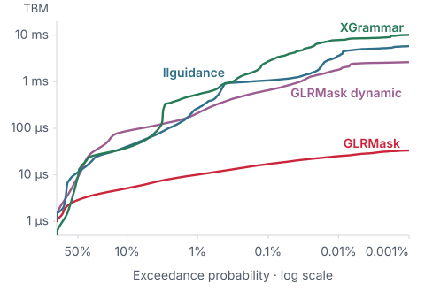

<!-- Generated by scripts/sync-guide.py from docs/content. Do not edit this output. -->

GLRMask is a grammar-constrained decoding library for high-throughput LLM serving. It is optimized for fast mask computation with extremely low tail latency, even for complex grammars.

GLRMask supports general context-free grammars, including ambiguous ones. It accepts JSON Schema, Lark and [GLRM](https://github.com/IsaacBreen/glrmask/blob/main/docs/glrm-format.md).

[Website](https://glrmask.com) · [Paper](https://doi.org/10.5281/zenodo.23273556)

## Benchmarks

### JSON Schema

Time between masks. Lower is better.

<p align="center">
<picture>
  <source media="(prefers-color-scheme: dark)" srcset="docs/assets/benchmark-tbm-json-guide-2026-10-19-dark.svg">
  
</picture>
</p>

**Time between masks (µs)**

| Statistic | GLRMask | GLRMask dynamic | llguidance | XGrammar |
|---|---:|---:|---:|---:|
| mean | 3.2 | 30.9 | 25.3 | 35.9 |
| p50 | 2.9 | 9.0 | 11.4 | 9.1 |
| p90 | 5.1 | 87.5 | 40.6 | 38.2 |
| p99 | 10.1 | 212.0 | 267.8 | 534.0 |
| p99.9 | 17.0 | 657.4 | 1,070.7 | 2,736.8 |
| p99.99 | 25.2 | 1,825.9 | 3,627.2 | 7,901.3 |
| max | 43.8 | 4,731.5 | 8,276.3 | 12,660.3 |

**Time to first mask (ms)**

| Statistic | GLRMask | GLRMask dynamic | llguidance | XGrammar |
|---|---:|---:|---:|---:|
| mean | 37.3 | 5.8 | 1.3 | 84.5 |
| p50 | 16.8 | 4.1 | 0.9 | 44.3 |
| p90 | 75.0 | 9.5 | 2.1 | 203.2 |
| p99 | 306.4 | 43.4 | 13.3 | 834.3 |
| max | 1,350.1 | 138.0 | 48.6 | 4,066.2 |

### JavaScript

Time between masks. Lower is better.

<p align="center">
<picture>
  <source media="(prefers-color-scheme: dark)" srcset="docs/assets/benchmark-tbm-javascript-guide-2026-10-19-dark.svg?v=72d7d58641e9">
  
</picture>
</p>

**Time between masks (µs)**

| Statistic | GLRMask | GLRMask dynamic | llguidance | XGrammar |
|---|---:|---:|---:|---:|
| mean | 17.2 | 1,126.5 | 1,152.4 | 116,561.8 |
| p50 | 18.4 | 26.5 | 938.6 | 47,894.1 |
| p90 | 30.1 | 3,582.2 | 2,661.0 | 621,935.7 |
| p99 | 46.7 | 4,100.1 | 3,389.5 | 679,617.9 |
| p99.9 | 63.6 | 4,617.6 | 3,761.8 | 805,342.2 |
| p99.99 | 69.3 | 4,814.8 | 3,819.2 | 825,890.1 |
| max | 69.6 | 4,849.1 | 3,825.7 | 826,881.4 |

**Time to first mask (ms)**

| Statistic | GLRMask | GLRMask dynamic | llguidance | XGrammar |
|---|---:|---:|---:|---:|
| JavaScript | 5,593.7 | 109.0 | 8.9 | 4,175.5 |

GLRMask’s dynamic mode trades some mask-generation speed for lower cold-start latency. It is heavily based on [llguidance](https://github.com/guidance-ai/llguidance).

19 October 2026 campaign · AWS c7i.16xlarge, Llama 3.1 8B Instruct vocabulary; GLRMask 3d65c7a, llguidance 1.9.1, XGrammar 0.2.8; matched valid trajectories (JSON: 1,570,228 positions; JavaScript: 2,370); JavaScript TTFM is a single cold observation. [Measurement details](https://glrmask.com/#benchmarks).

## Installation

### Python

```bash
python -m pip install glrmask
```

### Rust

```bash
cargo add glrmask
```

### Native C++ and Node.js

Native bindings are available for C++ and JavaScript/TypeScript on Node.js. The [C++ guide and C API](https://glrmask.com/api/cpp/) and [JavaScript and TypeScript guide](https://glrmask.com/api/javascript/) cover source builds, platform artifacts, ownership, composition, and the complete supported API. The Node.js addon does not run in browsers.

## Usage

GLRMask has four core types:

- `Grammar`: a grammar, written as source text or built from an expression.
- `Constraint`: a compiled grammar, ready to use.
- `ConstraintState`: the state of one generated sequence.
- `Module`: a partially compiled grammar ([see below](#composing-grammars)).

In the quickstart, supply the tokenizer's exact token bytes and the model's EOS ID. The model produces logits; the sampling routine must apply the packed mask and permit EOS only when the state is accepting.

### Python quickstart

```python
grammar = Grammar.from_json_schema({
    "type": "object",
    "properties": {
        "color": {
            "enum": ["red", "green", "blue"]
        }
    },
    "required": ["color"],
    "additionalProperties": False,
})

# Token ID -> exact bytes from tokenizer
vocab = Vocab(token_bytes)
state = grammar.compile(vocab).start()

output = []
while True:
    logits = model(output)
    mask = state.mask()
    token = sample(
        logits, mask, state.is_accepting()
    )
    if token == EOS:
        break
    if not state.commit_token(token):
        raise RuntimeError("Rejected token")
    output.append(token)
```

<details>
<summary>Full example</summary>

```python
from glrmask import Grammar, Vocab
import numpy as np

# Replace with your tokenizer's token bytes
token_bytes = {i: bytes([i]) for i in range(256)}
EOS = 256
rng = np.random.default_rng(0)
def model(output):
    return rng.standard_normal(257)
def sample(logits, mask, accepting):
    allowed = np.zeros(len(logits), dtype=bool)
    bits = np.unpackbits(mask.astype('<u4').view(np.uint8), bitorder='little')
    allowed[:EOS] = bits[:EOS]
    allowed[EOS] = accepting
    if not allowed.any():
        raise RuntimeError('no allowed token and cannot stop')
    return int(np.argmax(np.where(allowed, logits, -np.inf)))
grammar = Grammar.from_json_schema({
    "type": "object",
    "properties": {
        "color": {
            "enum": ["red", "green", "blue"]
        }
    },
    "required": ["color"],
    "additionalProperties": False,
})

# Token ID -> exact bytes from tokenizer
vocab = Vocab(token_bytes)
state = grammar.compile(vocab).start()

output = []
while True:
    logits = model(output)
    mask = state.mask()
    token = sample(
        logits, mask, state.is_accepting()
    )
    if token == EOS:
        break
    if not state.commit_token(token):
        raise RuntimeError("Rejected token")
    output.append(token)
assert state.is_accepting()
print(bytes(output).decode())
```

</details>

### Rust quickstart

```rust
let grammar = Grammar::from_json_schema(r#"
    {
        "type": "object",
        "properties": {
            "color": {
                "enum": [
                    "red", "green", "blue"
                ]
            }
        },
        "required": ["color"],
        "additionalProperties": false
    }
"#)?;

// Token ID -> exact bytes from tokenizer
let vocab = Vocab::new(token_bytes)?;
let constraint = grammar.compile(&vocab)?;
let mut state = constraint.start();

let mut output = Vec::new();
loop {
    let logits = model(&output);
    let mask = state.mask();
    let token = sample(
        &logits, &mask, state.is_accepting()
    );
    if token == EOS { break; }
    assert!(state.commit_token(token));
    output.push(token);
}
```

<details>
<summary>Full example</summary>

```rust
use glrmask::{Grammar, Vocab};
const EOS: u32 = 256;
fn model(output: &[u32]) -> Vec<f32> {
    (0..257).map(|t| ((t * 7919 + output.len() * 104_729) % 1000) as f32).collect()
}
fn sample(logits: &[f32], mask: &[u32], accepting: bool) -> u32 {
    (0..=EOS).filter(|&id| if id == EOS { accepting } else { mask[id as usize / 32] >> (id % 32) & 1 == 1 })
        .max_by(|&a, &b| logits[a as usize].total_cmp(&logits[b as usize])).expect("no allowed token and cannot stop")
}
fn main() -> glrmask::Result<()> {
// Replace with your tokenizer's token bytes
let token_bytes = (0..256u32).map(|id| (id, vec![id as u8]));
let grammar = Grammar::from_json_schema(r#"
    {
        "type": "object",
        "properties": {
            "color": {
                "enum": [
                    "red", "green", "blue"
                ]
            }
        },
        "required": ["color"],
        "additionalProperties": false
    }
"#)?;

// Token ID -> exact bytes from tokenizer
let vocab = Vocab::new(token_bytes)?;
let constraint = grammar.compile(&vocab)?;
let mut state = constraint.start();

let mut output = Vec::new();
loop {
    let logits = model(&output);
    let mask = state.mask();
    let token = sample(
        &logits, &mask, state.is_accepting()
    );
    if token == EOS { break; }
    assert!(state.commit_token(token));
    output.push(token);
}
assert!(state.is_accepting());
let bytes: Vec<u8> = output.into_iter().map(|t| t as u8).collect();
println!("{}", String::from_utf8_lossy(&bytes));
Ok(())
}
```

</details>

## Generating

Use one `ConstraintState` per sequence. Allow EOS when `is_accepting()` is true; stop if EOS is sampled. `is_terminated()` indicates that no further tokens or bytes are accepted. A rejected commit terminates the state.

For PyTorch serving, allocate a reusable packed mask on the CPU, with `V` equal to the logits width (at least each state's mask bit length):

```python
bitmask = torch.empty((len(states), (V + 31) // 32), dtype=torch.int32, pin_memory=True)
for i, state in enumerate(states):
    state.fill_mask(bitmask[i].numpy().view(np.uint32))
mask_on_device = bitmask.to(device, non_blocking=True)
# Apply the packed mask on the device. Wait for the transfer before reusing the CPU buffer.
```

### Forced bytes

`forced_bytes()` gives the bytes that must come next, stopping before a choice, an accepting position or a token-set item. To feed these bytes to a token-based model, tokenize them and commit the resulting tokens. Long forced runs may be returned in parts.

## Composing grammars

In a typical serving setup, a grammar constraint is one main grammar with smaller grammars nested inside it, some of which, like tool schemas, change from request to request. GLRMask is built to make this kind of composition cheap. Like modules in a program, grammars can be written and compiled as separate parts and combined later.

A server compiles its main grammar once as a `Module` with named externs. Each tool's schema is compiled on its own, in parallel or on another machine. For each request, GLRMask composes the main grammar with the compiled schemas by filling in the externs.

Resolving the interactions between them requires some extra *boundary* work. However, this work is usually small compared with compiling the grammars themselves, so composition remains cheap even when the grammars are large.

```python
# Token ID -> exact bytes from tokenizer
vocab = Vocab(token_bytes)

weather = Grammar.from_json_schema({
    "type": "object",
    "properties": {
        "city": {"type": "string"}
    },
    "required": ["city"],
    "additionalProperties": False,
}).compile(vocab)

parent = Grammar.from_glrm('''
    extern grammar ARGS
    start call
    nt call = "<weather>" ARGS
              "</weather>"
''')
call = Module(parent)
call.bind("ARGS", weather)
constraint = call.compile(vocab)
```

<details>
<summary>Full example</summary>

```python
from glrmask import Grammar, Module, Vocab
# Replace with your tokenizer's token bytes
token_bytes = {i: bytes([i]) for i in range(256)}
# Token ID -> exact bytes from tokenizer
vocab = Vocab(token_bytes)

weather = Grammar.from_json_schema({
    "type": "object",
    "properties": {
        "city": {"type": "string"}
    },
    "required": ["city"],
    "additionalProperties": False,
}).compile(vocab)

parent = Grammar.from_glrm('''
    extern grammar ARGS
    start call
    nt call = "<weather>" ARGS
              "</weather>"
''')
call = Module(parent)
call.bind("ARGS", weather)
constraint = call.compile(vocab)
```

</details>

```rust
// Token ID -> exact bytes from tokenizer
let vocab = Vocab::new(token_bytes)?;

let weather = Grammar::from_json_schema(r#"
    {
        "type": "object",
        "properties": {
            "city": {"type": "string"}
        },
        "required": ["city"],
        "additionalProperties": false
    }
"#)?.compile(&vocab)?;

let parent = Grammar::from_glrm(r#"
    extern grammar ARGS
    start call
    nt call = "<weather>" ARGS
              "</weather>"
"#)?;
let mut call = Module::new(&parent);
call.bind("ARGS", &weather)?;
let constraint = call.compile(&vocab)?;
```

<details>
<summary>Full example</summary>

```rust
use glrmask::{Grammar, Module, Vocab};
fn main() -> glrmask::Result<()> {
// Replace with your tokenizer's token bytes
let token_bytes = (0..256u32).map(|id| (id, vec![id as u8]));
// Token ID -> exact bytes from tokenizer
let vocab = Vocab::new(token_bytes)?;

let weather = Grammar::from_json_schema(r#"
    {
        "type": "object",
        "properties": {
            "city": {"type": "string"}
        },
        "required": ["city"],
        "additionalProperties": false
    }
"#)?.compile(&vocab)?;

let parent = Grammar::from_glrm(r#"
    extern grammar ARGS
    start call
    nt call = "<weather>" ARGS
              "</weather>"
"#)?;
let mut call = Module::new(&parent);
call.bind("ARGS", &weather)?;
let constraint = call.compile(&vocab)?;
let mut state = constraint.start();
assert!(state.commit_bytes(b"<weather>{\"city\": \"Perth\"}</weather>"));
assert!(state.is_accepting());
Ok(())
}
```

</details>

### Modules and expressions

A grammar extern accepts a grammar, module, constraint, expression or token set. A token extern accepts only a token set. Each extern is bound once; copy a module to use different bindings. Bindings capture the supplied values. A model token can span the boundary between grammar parts.

`precompile(vocab)` compiles as much of a module as possible with its current bindings. Precompiled work is tied to the vocabulary. Modules can be saved with unbound externs and loaded later.

Combine parts using `Expr.choice`, `Expr.sequence` and `Expr.literal`. Use `Grammar.from_expr` for expressions made entirely of grammar and literal parts; bind expressions containing compiled parts or token sets on a module.

## Token sets

A `TokenSet` matches one of its token IDs, including special tokens with no bytes. Token IDs can be allowed through an extern binding even if absent from the vocabulary. See [token sets](docs/token-sets.md).

## Mask strategies

`FAST_MASKS` favors fast mask computation; `FAST_COMPILE` favors fast compilation. `AUTO`, the default, currently prefers `FAST_MASKS`. Pass the preference when compiling or precompiling.

## Grammar formats

JSON Schema supports drafts 4, 6, 7, 2019-09 and 2020-12. Generated JSON follows the layout of Python's default `json.dumps`, including a space after commas and colons. Unsupported features raise errors.

See the [GLRM format](docs/glrm-format.md) and [Lark dialect](docs/lark-dialect.md) for grammar syntax and extensions.

## How it works

GLRMask maintains a GLR parser state for the generated prefix. A precomputed deterministic weighted automaton computes the next-token mask by reading each parser stack, intersecting Boolean vocabulary masks along each traversal and unioning alternative paths.

See [How it works](https://glrmask.com/implementation/) for the explanation and diagrams.
