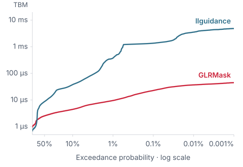
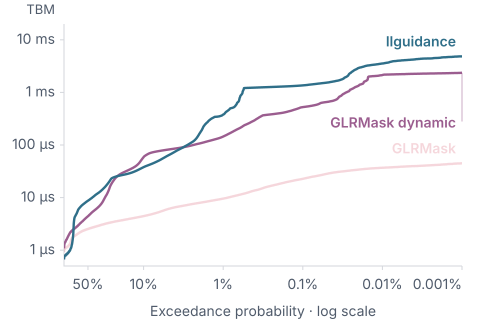

<!-- Generated by scripts/sync-guide.py from docs/content. Do not edit this output. -->

GLRMask is a grammar-constrained decoding library for high-throughput LLM serving. It is optimized for fast mask computation with extremely low tail latency, even for complex grammars.

GLRMask supports general context-free grammars, including ambiguous ones. Unfortunately, there is no universally accepted EBNF dialect. In keeping with this tradition, GLRMask includes its own: GLRM. It also supports JSON schemas and Lark.

[Website](https://glrmask.com) · [Paper](https://doi.org/10.5281/zenodo.23273556)

## Benchmarks

### JSON Schema

Time between masks. Lower is better.

<p align="center">
<picture>
  <source media="(prefers-color-scheme: dark)" srcset="docs/assets/benchmark-tbm-json-2026-10-08-dark.svg">
  
</picture>
</p>

**TBM (µs)**

| Statistic | GLRMask | llguidance |
|---|---:|---:|
| Mean | 2.9 | 27.5 |
| p50 | 2.5 | 8.7 |
| p99 | 9.5 | 379.6 |
| p99.9 | 22.7 | 1,360.9 |
| Max | 59.3 | 7,843.4 |

**Time to first mask (ms)**

| Statistic | GLRMask | llguidance |
|---|---:|---:|
| Mean | 27.4 | 0.8 |
| p50 | 9.7 | 0.5 |
| p99 | 229.4 | 6.9 |
| Max | 1,052.9 | 136.6 |

8 October 2026 · 2,925,983 aligned token positions · macOS 27 ARM64, 10 logical CPUs. [Benchmark details](docs/benchmark-cfa-2026-10-08.md).

#### Dynamic mode

Care about compile times? Try dynamic mode.

GLRMask’s dynamic mode trades some mask-generation speed for lower cold-start latency. It is heavily based on [llguidance](https://github.com/guidance-ai/llguidance).

<p align="center">
<picture>
  <source media="(prefers-color-scheme: dark)" srcset="docs/assets/benchmark-tbm-json-dynamic-2026-10-08-dark.svg">
  
</picture>
</p>

**Time to first mask (ms)**

| Stat | GLRMask | GLRMask<br>dynamic | llguidance |
|---|---:|---:|---:|
| Mean | 27.4 | 2.5 | 0.8 |
| p50 | 9.7 | 1.4 | 0.5 |
| p99 | 229.4 | 21.9 | 6.9 |
| Max | 1,052.9 | 132.0 | 136.6 |

[Explore Dynamic JSON results](https://glrmask.com/?dataset=json&mode=dynamic#benchmarks).

### JavaScript

Time between masks. Lower is better.

<p align="center">
<picture>
  <source media="(prefers-color-scheme: dark)" srcset="docs/assets/benchmark-tbm-javascript-2026-10-09-dark.svg?v=c26f751fe00e">
  
</picture>
</p>

**TBM (µs)**

| Statistic | GLRMask | llguidance |
|---|---:|---:|
| Mean | 17.0 | 1,101.9 |
| p50 | 18.8 | 938.0 |
| p99 | 37.6 | 3,125.0 |
| Max | 67.0 | 4,217.4 |

**Time to first mask (ms)**

| Statistic | GLRMask | llguidance |
|---|---:|---:|
| Mean | 3,674.4 | 5.7 |
| Selected | 3,674.4 | 5.8 |
| Max | 3,674.4 | 6.0 |

9 October 2026 · 31 examples, 4,099 token positions · macOS ARM64. [Benchmark details](docs/benchmark-javascript-2026-10-09.md).

Both datasets measure source builds, not the published 0.2 packages.

## Installation

### Python

```bash
python -m pip install glrmask
```

### Rust

```bash
cargo add glrmask
```

## Usage

GLRMask has three core types:

- `Grammar`: the language you want to generate.
- `Constraint`: a grammar compiled against a specific vocabulary.
- `ConstraintState`: the mutable state for a single generated sequence.

To use it, compile a `Grammar` into a `Constraint`, then call `constraint.start()` to initiate a `ConstraintState`. Then in the decoding loop:

1. Compute the next-token mask.
2. Sample a token the mask allows.
3. Commit that token to the state.

```python pseudocode
state = constraint.start()
end_token_ids = configured_end_token_ids

while generating:
    in parallel:
        logits = llm.forward(...)
        mask = state.mask()

    logits = apply_mask(logits, mask)
    token_id = sample(logits)
    state.commit_token(token_id)
    if token_id in end_token_ids:
        break
```

### Python quickstart

```bash
python -m pip install glrmask llama-cpp-python torch
```

```python
import numpy as np
from llama_cpp import Llama
from torch import from_numpy
from torch.distributions import Categorical

import glrmask

llm = Llama(model_path="model.gguf", logits_all=True)
vocab = glrmask.Vocab.from_llama_cpp(llm)
end_token_ids = vocab.llama_cpp_end_token_ids

schema = {"type": "string", "enum": ["positive", "negative", "neutral"]}
constraint = glrmask.Grammar.from_json_schema(schema).compile(
    vocab,
    end_tokens=end_token_ids,
    optimization=glrmask.Optimization.AUTO,
)

prompt = "Classify this review: The story dragged badly. Sentiment: "
input_tokens = llm.tokenize(prompt.encode())
llm.reset()
llm.eval(input_tokens)

state = constraint.start()
generated = []

for _ in range(64):
    logits = llm.scores[llm.n_tokens - 1]
    mask = state.mask(llm.n_vocab())
    logits[~mask] = -np.inf
    token_id = Categorical(logits=from_numpy(logits)).sample().item()

    llm.eval([token_id])
    generated.append(token_id)
    state.commit_token(token_id)
    if token_id in end_token_ids:
        break

print(llm.detokenize(generated).decode())
```

`state.mask()` returns a NumPy Boolean array indexed by model token ID. Pass a size when the model's logits vector is wider than the constraint's natural token coordinate.

### Rust quickstart

```rust
use glrmask::{BuildOptions, Grammar, Optimization, Vocab};

fn main() -> glrmask::Result<()> {
    let vocab = Vocab::new(vec![
        (0, b"\"yes\"".to_vec()),
        (1, b"\"no\"".to_vec()),
        (2, b"<eos>".to_vec()),
    ]);
    let schema = r#"{"type":"string","enum":["yes","no"]}"#;
    let constraint = Grammar::from_json_schema(schema).compile_with(
        &vocab,
        BuildOptions::default()
            .end_tokens([2])
            .optimization(Optimization::Auto),
    )?;

    let mut state = constraint.start();
    let mask = state.mask();
    assert_ne!(mask[0] & 1, 0); // Token 0 is allowed.
    state.commit_token(0)?;
    assert!(state.is_accepting());
    Ok(())
}
```

Rust masks are packed `u32` bitsets. Bit `token_id % 32` of word `token_id / 32` indicates whether that token is allowed.

### Source, compiled, and exact-token bindings

GLRM declares external references with `extern NAME;`. The value supplied to `Grammar::bind` determines whether a reference consumes exact token IDs or matches a source grammar. Attach compiled children with `UnlinkedConstraint::bind`:

```rust
use glrmask::{Grammar, Result, Vocab};

# fn demo(vocab: &Vocab) -> Result<()> {
let parent = Grammar::from_glrm(
    "glrm 1; start document; extern payload; nt document = payload;",
);
let source_child = Grammar::from_json_schema(r#"{"type":"null"}"#);
let source_composition = parent.bind("payload", &source_child)?;

let _a = source_composition.compile(vocab)?;
# Ok(())
# }
```

Exact token bindings come from the vocabulary rather than from naked IDs:

```rust
# use glrmask::{Grammar, Result, Vocab};
# fn demo(vocab: &Vocab, tool_call_id: u32) -> Result<()> {
let grammar = Grammar::from_glrm(
    "glrm 1; start message; extern TOOL_CALL; nt message = TOOL_CALL;",
);
let grammar = grammar.bind("TOOL_CALL", glrmask::Token::new(tool_call_id))?;
let _constraint = grammar.compile(vocab)?;
# Ok(())
# }
```

`Vocab::token(...)` and `Vocab::tokens(...)` retain the complete vocabulary identity. A value from an incompatible vocabulary is rejected even if the bound numeric ID happens to exist in both vocabularies.

Model control/tool tokens do not need fake byte spellings. When constructing a
Rust vocabulary manually, use `Vocab::new_with_exact_token_ids(byte_entries,
exact_only_ids)` for IDs that are valid exact-token bindings but must never
enter the byte language. Python's `Vocab.from_llama_cpp()` records omitted
control/EOG/empty-piece IDs this way automatically.

### Cached parents with `UnlinkedConstraint`

Use `compile_unlinked` when a compiled parent will be reused with request-specific children. A `UnlinkedConstraint` may remain open, can be saved and loaded, and is deliberately not runnable.

```rust
# use glrmask::{BuildOptions, Grammar, Optimization, Result, Vocab};
# fn demo(vocab: &Vocab) -> Result<()> {
let parent = Grammar::from_glrm(
    "glrm 1; start document; extern payload; nt document = payload;",
);
let host = parent.compile_unlinked(vocab)?;

let child_a = Grammar::from_ebnf(r#"start ::= "a""#).compile(vocab)?;
let child_b = Grammar::from_ebnf(r#"start ::= "b""#).compile(vocab)?;

let a = host.bind("payload", &child_a)?;
let b = host.bind("payload", &child_b)?;

let _constraint_a = a.link_with(
    BuildOptions::default().optimization(Optimization::FastRuntime),
)?;
let _constraint_b = b.link()?;
# Ok(())
# }
```

`UnlinkedConstraint::bind` is compiled-only: it accepts a compiled `Constraint` or a exact-token value. It does not accept an unresolved `UnlinkedConstraint`, and it does not parse or compile source children. Link a child first before binding it to the parent. Composition stays deferred until `link`/`link_with`, so the final optimization preference can choose the boundary construction strategy.

Python uses the same lifecycle:

```python
parent = glrmask.Grammar.from_glrm(
    'glrm 1; start document; extern payload; nt document = payload;'
)
host = parent.compile_unlinked(vocab)
child = glrmask.Grammar.from_json_schema(payload_schema).compile(vocab)
constraint = host.bind("payload", child).link(
    optimization=glrmask.Optimization.FAST_RUNTIME,
)
```

### Build/runtime trade-off

GLRMask’s dynamic mode trades some mask-generation speed for lower cold-start latency. It is heavily based on [llguidance](https://github.com/guidance-ai/llguidance).

`Optimization` expresses intent rather than exposing internal engine names:

- `AUTO` / `Auto`: let GLRMask choose.
- `FAST_BUILD` / `FastBuild`: ordinary Dynamic compilation and masking (O1).
- `BALANCED` / `Balanced`: bounded native parser with vocabulary partitioning (O2).
- `FAST_RUNTIME` / `FastRuntime`: spend more build work to favor lower mask latency where supported.

All four modes preserve accepted-language semantics and produce the same public `Constraint` type.

### Native template parser backend

Public final-constraint APIs select their parser representation internally.
Callers choose `Optimization`; there is no public parser backend selector or
accessor. Parser-provider construction remains internal repository tooling.

The native runtime and its artifact contain the template relations, not an
LR table. Mask generation and token commitment use the existing shared engines;
parser advancement and admissibility use those relations. Built-in grammar
compilation can use temporary LR analysis to derive the program, then discards
the table before constructing a `Constraint`. Native runtime table access and implicit LR fallback panic. Ordinary Dynamic
(O1), selected by FastBuild, retains and executes its LR table.
Data-only parser providers remain available through Rust's `internal-api`
feature and Python's `_internal` namespace.

Built-in compiled components with finite embedding transfers support nested
and nullable [template composition](docs/template-parser-composition.md).
Compiled components link directly through shared immutable template graphs and
scoped views. Unsupported native requests return errors. Performance and load-time tradeoffs depend on the
grammar and mode, so template selection is not an automatic speed guarantee.
See [the template parser contract](docs/template-parser.md) for provider
examples, exact POP/READ/PUSH semantics, validation, and persistence.
The [September 30 validation report](docs/template-parser-validation-2026-09-30.md)
records historical measurements at its pinned revision. Those measurements do
not qualify the current native replacement.

### Ordinary Dynamic development backend

Ordinary Dynamic (O1) defaults to the retained LR runtime. Its grammar, lexer,
vocabulary, masking and commit code share the existing compiler/runtime pipeline;
it skips native parser characterization, template construction and native runtime
metadata. O2/Balanced continues to build templates, and Static is unchanged.

For internal development only, `GLRMASK_DYNAMIC_TEMPLATE_DFA=1` selects native
parser templates for an ordinary Dynamic compilation (`true`, `yes` and `on`
also enable it). An absent/disabled variable selects LR. This choice is resolved
before compiler worker pools and does not affect O2, Static, existing objects or
artifact loading. There is no new public backend configuration. Serialized
artifacts preserve their built representation and external-vocabulary artifacts
require the exact original mapping.

### End tokens are final-root policy

End-token policy belongs to the final `compile`/`compile_with` or `link`/`link_with` operation. It is not inherited when a completed `Constraint` is embedded as a child.

```python
constraint = grammar.compile(vocab, end_tokens=[eos_id])
state = constraint.start()
# eos_id is allowed only when the grammar body is accepting.
```

A state reports `is_accepting()` for grammar-body acceptance and `is_rejected()` for an irrecoverable invalid prefix. Callers choose between stopping at the first complete match with `is_accepting()` or permitting continuation until a configured end-token ID is sampled and committed. Always commit the chosen token before checking for an end-token break; acceptance alone does not mean an end token was consumed. Committing an allowed end token empties the next-token mask, keeps the state accepting and non-rejected, and rejects further commits.

### Persistence

Both compiled object types are serializable:

```python
module_bytes = host.save()
host = glrmask.UnlinkedConstraint.load(module_bytes)

constraint_bytes = constraint.save()
constraint = glrmask.Constraint.load(constraint_bytes)
```

A loaded `Constraint` retains its selected backend. Built-in template-backed children retain their finite embedding transfers and can be linked with the template backend; arbitrary data-only and older artifacts may lack those transfers. A child's standalone end-token policy is stripped when embedded, while its compiled grammar body is retained.

## Grammar formats

GLRMask accepts JSON Schema, GLRM, Lark, and EBNF. GLRM is the native composition format. A grammar begins with `glrm 1;` and a `start` declaration:

```glrm
glrm 1;
start value;

t NUMBER = /-?(0|[1-9][0-9]*)/;
nt value = NUMBER | "null";
```

Declarations use `=`, epsilon is written as `eps`, and regexes use full-match semantics. Inline `g name = { ... };` grammars and externally bound `extern name;` slots have the same language semantics, including scope-local ignores.

An external reference can consume one ordinary or special model-token ID when bound to `glrmask.Token(id)`:

```python
grammar = glrmask.Grammar.from_glrm('''
glrm 1;
start message;
extern TOOL_CALL;
nt message = TOOL_CALL "lookup()";
''')
constraint = grammar.bind("TOOL_CALL", glrmask.Token(tool_call_token_id)).compile(vocab)
```

Lark and EBNF also support explicit `@token(<id>)` atoms when the numeric ID is deliberately part of the grammar source.

## How it works

GLRMask maintains a GLR parser state for the generated prefix. A precomputed deterministic weighted automaton computes the next-token mask by reading each parser stack, intersecting Boolean vocabulary masks along each traversal and unioning alternative paths.

See [How it works](https://glrmask.com/implementation/) for the explanation and diagrams.
