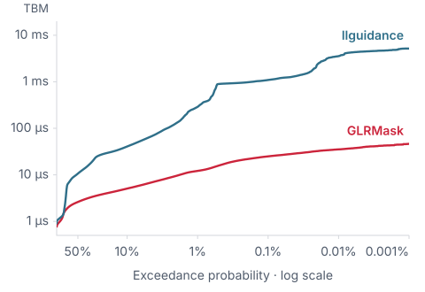
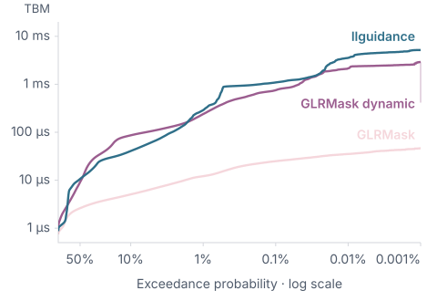

<!-- Generated by scripts/sync-guide.py from docs/content. Do not edit this output. -->

GLRMask is a grammar-constrained decoding library for high-throughput LLM serving. It is optimized for fast mask computation with extremely low tail latency, even for complex grammars.

GLRMask supports general context-free grammars, including ambiguous ones. It accepts JSON Schema, Lark and [GLRM](https://github.com/IsaacBreen/glrmask/blob/main/docs/glrm-format.md).

[Website](https://glrmask.com) · [Paper](https://doi.org/10.5281/zenodo.23273556)

## Benchmarks

### JSON Schema

Time between masks. Lower is better.

<p align="center">
<picture>
  <source media="(prefers-color-scheme: dark)" srcset="docs/assets/benchmark-tbm-json-2026-10-14-dark.svg">
  
</picture>
</p>

**TBM (µs)**

| Statistic | Static | Dynamic | llguidance |
|---|---:|---:|---:|
| Mean | 3.0 | 31.5 | 25.9 |
| p50 | 2.6 | 9.1 | 10.6 |
| p90 | 5.1 | 86.4 | 40.7 |
| p99 | 12.2 | 239.5 | 289.9 |
| p99.9 | 24.9 | 754.2 | 1,092.6 |
| Max | 283.1 | 3,647.8 | 6,931.5 |

**Time to first mask (ms)**

| Statistic | Static | Dynamic | llguidance |
|---|---:|---:|---:|
| Mean | 33.7 | 3.9 | 1.2 |
| p50 | 12.6 | 2.3 | 0.8 |
| p90 | 78.9 | 6.5 | 1.8 |
| p99 | 302.3 | 35.9 | 11.1 |
| p99.9 | 854.3 | 88.8 | 17.9 |
| Max | 1,293.4 | 274.6 | 231.0 |

Static measured the parser DWA implementation; Dynamic measured token-trie traversal. These are historical engine measurements, not performance guarantees for the current presets.

14 October 2026 · 11,277 complete valid trajectories accepted by all measured engines · 1,734,930 TBM positions per engine · 8,326 common-built cases for TTFM. One unpinned native wall-clock timing run on AWS c8i.8xlarge (Intel Xeon 6975P-C, 32 available CPUs). Vocabulary preparation is excluded.

### JavaScript

Time between masks. Lower is better.

<p align="center">
<picture>
  <source media="(prefers-color-scheme: dark)" srcset="docs/assets/benchmark-tbm-javascript-2026-10-14-dark.svg?v=5274bdb45744">
  
</picture>
</p>

**TBM (µs)**

| Statistic | Static | Dynamic | llguidance |
|---|---:|---:|---:|
| Mean | 16.9 | 1,392.4 | 1,052.2 |
| p50 | 18.2 | 145.5 | 856.6 |
| p90 | 30.4 | 3,626.1 | 2,521.7 |
| p99 | 47.9 | 4,091.7 | 3,097.0 |
| p99.9 | 71.1 | 4,656.9 | 3,597.1 |
| Max | 77.4 | 5,517.4 | 3,867.9 |

**Time to first mask (ms)**

| Statistic | Static | Dynamic | llguidance |
|---|---:|---:|---:|
| Mean | 5,089.4 | 113.3 | 8.0 |
| p50 | 5,099.6 | 113.0 | 8.0 |
| p90 | 5,152.7 | 116.9 | 8.1 |
| p99 | 5,223.0 | 120.7 | 8.2 |
| p99.9 | 5,225.9 | 121.7 | 8.2 |
| Max | 5,226.2 | 121.8 | 8.2 |

Static measured the parser DWA implementation; Dynamic measured token-trie traversal. These are historical engine measurements, not performance guarantees for the current presets.

14 October 2026 · 28 complete valid trajectories accepted by all measured engines · 3,805 TBM positions per engine · 55 common-built cases for TTFM. One unpinned native wall-clock timing run on AWS c8i.8xlarge (Intel Xeon 6975P-C, 32 available CPUs). Vocabulary preparation is excluded.

#### Dynamic mode

GLRMask’s dynamic mode trades some mask-generation speed for lower cold-start latency. It is heavily based on [llguidance](https://github.com/guidance-ai/llguidance).

<p align="center">
<picture>
  <source media="(prefers-color-scheme: dark)" srcset="docs/assets/benchmark-tbm-json-dynamic-2026-10-14-dark.svg">
  
</picture>
</p>

[Explore Dynamic JSON results](https://glrmask.com/?dataset=json&mode=dynamic#benchmarks).

There was no CPU pinning or SMT sibling reservation, and checkpoint publication overlapped the benchmark. Saved telemetry cannot isolate scheduling effects; latency stabilization is not certified. Successful builds do not establish semantic correctness. All 9,558 JSON schemas were attempted: build errors are Dynamic 232, Static 233 and llguidance 1,226. Incorrect examples are 460 for each GLRMask mode and 100 for llguidance; runtime-error examples are 0 and 6 respectively. JavaScript attempts all 55 fixtures: all builds succeed, with 1 incorrect example per GLRMask mode and 4 for llguidance. Headline TBM excludes incomplete or nonaccepted valid trajectories; all outcomes remain in the raw records. This finite corpus does not establish full-language equivalence or whole-corpus dominance.

[Native AWS benchmark details](https://github.com/IsaacBreen/glrmask/blob/main/docs/benchmark-aws-2026-10-14.md). Historical [October 8 Mac JSON](https://github.com/IsaacBreen/glrmask/blob/main/docs/benchmark-cfa-2026-10-08.md) and [October 9 Mac JavaScript](https://github.com/IsaacBreen/glrmask/blob/main/docs/benchmark-javascript-2026-10-09.md) reports are retained with their original measurement protocols. These are source builds, not measurements of the published packages.

## Installation

### Python

```bash
python -m pip install glrmask
```

### Rust

```bash
cargo add glrmask
```

### Native C++ and Node.js

Native bindings are available for C++ and JavaScript/TypeScript on Node.js. The [C++ guide and C API](https://glrmask.com/api/cpp/) and [JavaScript and TypeScript guide](https://glrmask.com/api/javascript/) cover source builds, platform artifacts, ownership, composition, and the complete supported API. The Node.js addon does not run in browsers.

## Usage

GLRMask has four core types:

- `Grammar`
- `Module`: a partially compiled grammar.
- `Constraint`: a compiled grammar, ready to use.
- `ConstraintState`: the state of one generated sequence.

### Python quickstart

```python
import numpy as np
import glrmask

grammar = glrmask.Grammar.from_json_schema({
    "type": "object",
    "properties": {"color": {"enum": ["red", "green", "blue"]}},
    "required": ["color"],
    "additionalProperties": False,
})

# One token per byte, plus EOS. With a real model, build this from its tokenizer.
vocab = glrmask.Vocab({i: bytes([i]) for i in range(256)})
EOS = 256

state = grammar.compile(vocab).start()
rng = np.random.default_rng(0)
output = []
while True:
    logits = rng.standard_normal(257)  # stand-in for your model
    allowed = np.zeros(257, dtype=bool)
    m = state.mask()
    allowed[:state.mask_bit_len] = np.unpackbits(m.astype('<u4').view(np.uint8), bitorder='little')[:state.mask_bit_len].astype(bool)
    allowed[EOS] = state.is_accepting()
    if not allowed.any():
        raise RuntimeError("no allowed token and cannot stop")
    token = int(np.argmax(np.where(allowed, logits, -np.inf)))
    if token == EOS:
        break
    if not state.commit_token(token):
        raise RuntimeError("allowed token rejected")
    output.append(token)

print(bytes(output).decode())  # e.g. {"color": "blue"}
```

### Rust quickstart

```rust
use glrmask::{Grammar, Vocab};

fn main() -> glrmask::Result<()> {
    let grammar = Grammar::from_json_schema(r#"{
        "type": "object",
        "properties": {"color": {"enum": ["red", "green", "blue"]}},
        "required": ["color"],
        "additionalProperties": false
    }"#)?;

    // One token per byte, plus EOS. With a real model, build this from its tokenizer.
    let vocab = Vocab::new((0..256u32).map(|b| (b, vec![b as u8])))?;
    const EOS: u32 = 256;

    let mut state = grammar.compile(&vocab)?.start();
    let mut output = Vec::new();
    loop {
        let logits = model(&output); // stand-in for your model
        let mask = state.mask();
        let allowed = |t: u32| match t {
            EOS => state.is_accepting(),
            t => mask[t as usize / 32] >> (t % 32) & 1 == 1,
        };
        let token = (0..=EOS)
            .filter(|&t| allowed(t))
            .max_by(|&a, &b| logits[a as usize].total_cmp(&logits[b as usize]))
            .expect("no allowed token and cannot stop");
        if token == EOS {
            break;
        }
        assert!(state.commit_token(token), "allowed token rejected");
        output.push(token as u8);
    }
    println!("{}", String::from_utf8_lossy(&output)); // e.g. {"color": "blue"}
    Ok(())
}

fn model(output: &[u8]) -> Vec<f32> {
    (0..257).map(|t| ((t * 7919 + output.len() * 104_729) % 1000) as f32).collect()
}
```

## Generating

Each sequence has its own `ConstraintState`. At each step, mask the model's scores, allow EOS when the state is accepting, and choose a token. Stop if EOS is chosen; otherwise commit the token:

See the quickstart above for the sampling loop and unpacking the packed mask.


Masks indicate which tokens are allowed next, as a bitmask: token `i` is bit `i % 32` of word `i // 32`.
Python `mask_bit_len` (a method in Rust and C++, `maskBitLength` in Node) is the mask's length in bits (the largest token ID plus one, or zero if empty), including gaps.
Allocate `(c.mask_bit_len + 31) // 32` words for `fill_mask`, which writes into reusable storage and zeros surplus words.
Python `mask()` returns packed uint32 words. Use `mask().view(np.int32)` for signed packed words without copying.
The constraint and each state have the same constant mask bit length.
For a wider packed mask, allocate the required words and use `fill_mask`. It accepts writable contiguous
1-D aligned, native-endian NumPy uint32 arrays (including rows of C-contiguous matrices); for an int32 buffer, pass `buf.view(np.uint32)`; all words are written, and surplus words are zeroed on success. Buffer validation errors leave it unchanged; an unexpected internal failure may have partially written it. Mask computation may release the GIL. Compile and precompile run native compilation without the GIL. Concurrent calls must use different states and nonoverlapping buffers; do not access or resize the buffer (including aliases) during the call.

For PyTorch serving with V equal to the logits width (at least every state mask bit length):

```python
# CPU staging buffer, with each row reused for one sequence.
bitmask = torch.empty((len(states), (V + 31) // 32), dtype=torch.int32, pin_memory=True)
for i, state in enumerate(states):
    state.fill_mask(bitmask[i].numpy().view(np.uint32))  # zero-copy view of the CPU row
mask_on_device = bitmask.to(device, non_blocking=True)
# Apply mask_on_device with your packed-mask kernel. Do not reuse the CPU
# buffer until the asynchronous transfer completes.
```

`commit_token` advances the state by the token. `commit_bytes` advances it by the bytes, such as a prefix you supply. Text never matches a token set. A failed commit terminates the state, so to try a
token without committing to it, copy the state first.

`is_accepting()` says whether the output so far could end here. More may still be allowed: `1+2` is complete, but
`1+23` is too. `is_terminated()` says whether nothing more can be committed. Together they distinguish in progress (false, false), may stop (true, false), complete (true, true), and dead (false, true). Treat EOS as a caller-side stop decision; committing an unknown EOS token rejects even an accepting state.

### Forced bytes

`forced_bytes()` returns the bytes that must come next. Commit them with `commit_bytes()`. If feeding tokens to a model, tokenize the bytes and commit those tokens instead. The query stops before a choice, an accepting position or a token-set item. Handle special tokens yourself. Long forced runs may be returned in parts; call again after committing.


## Composing grammars

A grammar can declare externs: named slots that you bind later.

- `extern grammar NAME` takes a grammar or expression; on a `Module` it can also take a module or token set.
- `extern token NAME` can be declared on a Grammar but must be filled on a Module with a token set. It matches exactly one of those tokens, never their text.

```python
import glrmask

weather = glrmask.Grammar.from_json_schema(
    '{"type": "object", "properties": {"city": {"type": "string"}},'
    ' "required": ["city"], "additionalProperties": false}')
search = glrmask.Grammar.from_json_schema(
    '{"type": "object", "properties": {"query": {"type": "string"}},'
    ' "required": ["query"], "additionalProperties": false}')
call_format = glrmask.Grammar.from_glrm('''
    extern grammar WEATHER_ARGS
    extern grammar SEARCH_ARGS
    start call
    nt call = "<weather>" WEATHER_ARGS "</weather>" | "<search>" SEARCH_ARGS "</search>"
''')

call = call_format.copy()
call.bind("WEATHER_ARGS", weather)
call.bind("SEARCH_ARGS", search)

vocab = glrmask.Vocab({i: bytes([i]) for i in range(256)})
state = call.compile(vocab).start()
assert state.commit_bytes(b'<weather>{"city": "Perth"}</weather>')
assert state.is_accepting()
```

Each grammar keeps its own rules, including the whitespace it ignores, and one model token can span the boundary
between parts.

`bind` changes the grammar or module in place; copy it first to bind the same one in different ways. Each extern is
bound once, on the grammar or module that declares it. An unknown name is an error; an unbound name accepts a value of the appropriate kind; an already bound name rejects rebinding. Bindings capture values, not later mutations. A value can't be bound while it has unbound externs of its own.
`externs` is a read-only mapping of extern names to `Extern`, and `externs.unbound` lists the ones not yet bound (in Rust, `externs()`
and `externs().unbound()`). This is a shallow view of the direct declarations, not a recursive search. Qualified names use `::` for scoped declarations.

### Modules

A `Grammar` holds source and bindings. A `Module` can also hold model-specific token IDs and precompiled work. `precompile(vocab)` compiles as much as it can now,
even with externs unbound, and `compile` finishes compiling the module into a constraint. Use modules when the same parts appear in many grammars. Tool
calls are the typical case: precompile each tool's schema once, and any combination of tools then compiles quickly.

```python
weather_args = glrmask.Module(weather)
weather_args.precompile(vocab)
search_args = glrmask.Module(search)
search_args.precompile(vocab)

call = glrmask.Module(call_format)
call.precompile(vocab)
call.bind("WEATHER_ARGS", weather_args)
call.bind("SEARCH_ARGS", search_args)
constraint = call.compile(vocab)
```


`module.save()` returns bytes, and `Module.load(data)` restores the module with its bindings and precompiled work. A
module can be saved with externs unbound. Precompiled work is for one vocabulary; compiling or precompiling it with another is an error.

`constraint.save()` and `Constraint.load(data, vocab)` save and load a compiled constraint. The vocabulary isn't saved,
and `load` checks that you pass the one it was compiled for. Bytes saved by one GLRMask version may not load in another. Load artifacts only from trusted sources; malformed input is rejected where detected, but this is not a hardened untrusted-data parser.

### Expressions

`Expr.choice(*parts)` matches any one of its parts, `Expr.sequence(*parts)` matches them one after another, and
`Expr.literal(text)` matches exactly `text`, with no whitespace skipped. Parts can be grammars, modules, expressions and
token sets. `Grammar.from_expr` makes a grammar from an expression that contains neither modules nor token sets, including nested parts. Expressions containing either can be bound to a `Module`.

## Token sets

A `TokenSet` is a set of token IDs. In a grammar it matches any one of its tokens. Create one from IDs,
`TokenSet([1, 2, 3])`, or from ranges, `TokenSet([range(0, 10)])`. Ranges in C and C++ use `{start, end}` with `end` excluded, as in every language. Rust takes only half-open ranges such as `0..10`. Empty ranges contribute no tokens; reversed C/C++/Node ranges are invalid. Sets are normalized, merging overlapping and adjacent ranges. Python ranges may have any step. An ID doesn't need to be in the vocabulary.

Vocabulary and token-set constructors reject IDs outside the supported range. In Rust, constructing a token set with such an ID panics.

Tokens with no bytes, such as tool-call markers, are special tokens. They never match text, so only a token set can allow one in a mask, and they don't need to be in the vocabulary. Two tokens with the same bytes are still different tokens to a token set. See [token sets](https://github.com/IsaacBreen/glrmask/blob/main/docs/token-sets.md).

## Mask strategies

`MaskStrategy` controls how the constraint is compiled:

- `AUTO` (Rust/Python), `Auto` (Node/C++): The default; currently `FAST_MASKS` (`FastMasks` in Node/C++).
- `FAST_COMPILE` (Rust/Python), `FastCompile` (Node/C++): Faster compilation, slower masks.
- `FAST_MASKS` (Rust/Python), `FastMasks` (Node/C++): Faster masks, slower compilation.

These are preferences, not speed guarantees. GLRMask may use another strategy; masks have the same semantics. AUTO does not reject a grammar merely because a particular strategy is unsupported.

Pass the preference to `compile` on a Grammar or Module, or to `precompile` on a Module.

```python
constraint = grammar.compile(vocab, mask_strategy=glrmask.MaskStrategy.FAST_MASKS)
```

## Errors

Creating, binding, compiling and loading grammars can fail. Commits return `false` only on rejection; internal failures panic in Rust and surface as errors in foreign bindings. Discard a state after an internal failure.
Each error message says what went wrong, with the line and column in the grammar source when that's the cause.
In Rust, `Error::kind()` gives the kind of error: `Syntax`, `InvalidInput`, `Compilation`, `ResourceLimit`, `StrategyUnsupported`, `Serialization`, `VocabMismatch`, `BufferTooSmall` or `Internal`. `source_span()` gives its place in the source.
Python raises `GLRMaskError` (an `Exception`) with a `kind` string: one of `"syntax"`, `"invalid_input"`, `"compilation"`, `"resource_limit"`, `"strategy_unsupported"`, `"serialization"`, `"vocab_mismatch"`, `"buffer_too_small"`, `"internal"`. Node.js throws a `GLRMaskError` with a `code`, C returns a status and sets `glrmask_error_message()`, and C++ throws `glrmask::Error`.

## Grammar formats

**JSON Schema.** Drafts 4, 6, 7, 2019-09 and 2020-12, chosen by `$schema`; without one, 2020-12. `format` is treated as
an annotation, and `oneOf` requires exactly one match. A schema feature GLRMask can't enforce is an error. The JSON
has one layout, the one Python's `json.dumps` writes by default: no whitespace outside strings except a space after each
`,` and `:`, as in `{"a": [1, 2]}`.

**[GLRM](https://github.com/IsaacBreen/glrmask/blob/main/docs/glrm-format.md)** has terminals (`t`) and nonterminals (`nt`), externs, scoped grammars, and
regular-expression intersection and subtraction.

```glrm
start value
t INTEGER = /-?(0|[1-9][0-9]*)/
nt value = INTEGER | "null"
```

**Lark**, with GLRMask's additions: `<|name|>` for a token extern, `@name` for a grammar extern, `%json` for an inline
JSON Schema and `[lazy]` for a terminal that ends as soon as it can. See [Lark](https://github.com/IsaacBreen/glrmask/blob/main/docs/lark-dialect.md).

Features GLRMask doesn't support, such as Lark priorities, are errors. They are never silently ignored.

## Design principles

These are the design principles that constrain GLRMask's API.

### Safe by default

Special tokens are privileged. They switch roles, call tools and end turns, and the software running a model acts on them. A grammar, though, may come from an untrusted source, such as an API user, a tool definition or a shared library. If grammar source could allow special tokens, an untrusted grammar could make the model fake a role switch or a tool call, requiring every untrusted grammar to be validated before use.

In GLRMask, grammar source cannot introduce token-level matches. A name such as `<|finish|>` in grammar source declares a token slot, which allows nothing until code binds a TokenSet on a Module.

### Working without masks

Suppose you want to know whether any more input can be accepted. A brute-force and obviously impractical way is to commit every possible next byte and special token, each on a copy of the state, and see if any are accepted. You could also check whether the mask is empty, but you shouldn't need to compute masks to use GLRMask. (You might be implementing rejection sampling with the commit functions alone, for example.) This motivates `is_terminated`, which tells you directly.

## How it works

GLRMask maintains a GLR parser state for the generated prefix. A precomputed deterministic weighted automaton computes the next-token mask by reading each parser stack, intersecting Boolean vocabulary masks along each traversal and unioning alternative paths.

See [How it works](https://glrmask.com/implementation/) for the explanation and diagrams.
