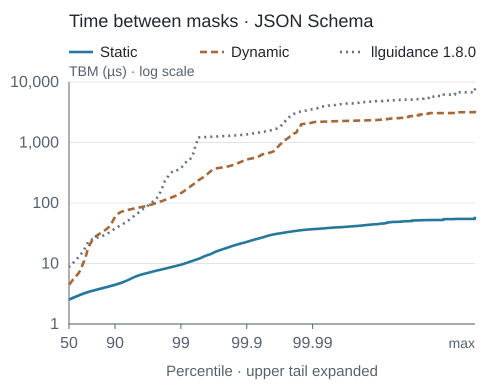

GLRMask is a grammar-constrained decoding library for high-throughput LLM serving. It is optimized for fast mask computation with extremely low tail latency, even for complex grammars.

GLRMask supports general context-free grammars, including ambiguous ones. Unfortunately, there is no universally accepted EBNF dialect. In keeping with this tradition, GLRMask includes its own: GLRM. It also supports JSON Schema and Lark.

[Website](https://glrmask.com/) · [Python docs](https://glrmask.com/reference/python/) · [Rust docs](https://docs.rs/glrmask) · [Paper](https://doi.org/10.5281/zenodo.23273556)

<!-- benchmark-overview:start -->
Time between masks (TBM) measures token commitment through the next ready mask. On the measured JSON Schema cohort, GLRMask Static has a 2.5 µs median and 9.5 µs p99, compared with 8.7 µs and 379.6 µs for llguidance. See [Performance](#performance) for compilation costs and methodology.

<p align="center">
  <picture>
    <source media="(prefers-color-scheme: dark)" srcset="docs/assets/benchmark-tbm-2026-10-08-dark.svg">
    
  </picture>
</p>

*JSONSchemaBench, 8 October 2026: 2,925,983 aligned token positions; calling-thread CPU time, minimum of two native processes. Lower is better. See [measurement details](docs/benchmark-cfa-2026-10-08.md).*
<!-- benchmark-overview:end -->

## Installation

### Python

```bash
python -m pip install glrmask
```

### Rust

```bash
cargo add glrmask
```

**Documentation:** [Python](https://github.com/IsaacBreen/glrmask/blob/main/python/README.md) · [Rust](https://docs.rs/glrmask)

## Usage

GLRMask has three ordinary public layers:

- `Grammar` is a source grammar description. It can contain source children and vocabulary-qualified exact-token bindings.
- `UnlinkedConstraint` is reusable compiled machinery for one exact vocabulary. It may deliberately remain open and is not runnable.
- `Constraint` is closed, rooted, and immediately runnable. `ConstraintState` is the mutable per-sequence state.

Bindings are immutable. Calling `bind(...)` returns a new `Grammar` or `UnlinkedConstraint`; the original remains reusable.

At runtime, call `constraint.start()` once per generated sequence. Compute the next-token mask, sample an allowed model token, then commit that token. If the constraint was built with end tokens, those IDs become maskable only when the grammar body is accepting; committing one empties the next-token mask, keeps the state accepting and non-rejected, and rejects further commits.

```text
state = constraint.start()

# Stop at the first complete match:
while not state.is_accepting():
    in parallel:
        logits = llm.forward(...)
        mask = state.mask()

    logits = apply_mask(logits, mask)
    token_id = sample(logits)
    state.commit_token(token_id)
```

### Python quickstart

```bash
python -m pip install glrmask llama-cpp-python torch
```

```python
import numpy as np
from llama_cpp import Llama
from torch import from_numpy
from torch.distributions import Categorical

import glrmask

llm = Llama(model_path="model.gguf", logits_all=True)
vocab = glrmask.Vocab.from_llama_cpp(llm)
end_token_ids = vocab.llama_cpp_end_token_ids

schema = {"type": "string", "enum": ["positive", "negative", "neutral"]}
constraint = glrmask.Grammar.from_json_schema(schema).compile(
    vocab,
    end_tokens=end_token_ids,
    optimization=glrmask.Optimization.AUTO,
)

prompt = "Classify this review: The story dragged badly. Sentiment: "
input_tokens = llm.tokenize(prompt.encode())
llm.reset()
llm.eval(input_tokens)

state = constraint.start()
generated = []

for _ in range(64):
    logits = llm.scores[llm.n_tokens - 1]
    mask = state.mask(llm.n_vocab())
    logits[~mask] = -np.inf
    token_id = Categorical(logits=from_numpy(logits)).sample().item()

    llm.eval([token_id])
    generated.append(token_id)
    state.commit_token(token_id)
    if state.is_accepting():
        break

print(llm.detokenize(generated).decode())
```

Acceptance indicates the grammar body is complete. Because an accepting state may also admit continuation tokens (or configured end tokens), callers that want to permit continuation past the first complete match can instead sample until a configured end token is chosen and committed.

`state.mask()` returns a NumPy Boolean array indexed by model token ID. Pass a size when the model's logits vector is wider than the constraint's natural token coordinate.

### Rust quickstart

```rust
use glrmask::{BuildOptions, Grammar, Optimization, Vocab};

let vocab = Vocab::new(vec![
    (0, b"\"yes\"".to_vec()),
    (1, b"\"no\"".to_vec()),
    (2, b"<eos>".to_vec()),
]);
let schema = r#"{"type":"string","enum":["yes","no"]}"#;
let constraint = Grammar::from_json_schema(schema).compile_with(
    &vocab,
    BuildOptions::default()
        .end_tokens([2])
        .optimization(Optimization::Auto),
)?;

let mut state = constraint.start();
let mask = state.mask();
state.commit_token(0)?;
assert!(state.is_accepting());
# Ok::<(), glrmask::Error>(())
```

Rust masks are packed `u32` bitsets. Bit `token_id % 32` of word `token_id / 32` indicates whether that token is allowed.

### Source, compiled, and exact-token bindings

GLRM declares child slots with `extern grammar NAME;` and exact-token slots with `extern token NAME;`. `Grammar::bind` attaches source grammars or vocabulary-qualified exact-token values. Attach compiled children with `UnlinkedConstraint::bind`:

```rust
use glrmask::{Grammar, Result, Vocab};

# fn demo(vocab: &Vocab) -> Result<()> {
let parent = Grammar::from_glrm(
    "glrm 1; start document; extern grammar payload; nt document = payload;",
);
let source_child = Grammar::from_json_schema(r#"{"type":"null"}"#);
let source_composition = parent.bind("payload", &source_child)?;

let _a = source_composition.compile(vocab)?;
# Ok(())
# }
```

Exact token bindings come from the vocabulary rather than from naked IDs:

```rust
# use glrmask::{Grammar, Result, Vocab};
# fn demo(vocab: &Vocab, tool_call_id: u32) -> Result<()> {
let grammar = Grammar::from_glrm(
    "glrm 1; start message; extern token TOOL_CALL; nt message = TOOL_CALL;",
);
let grammar = grammar.bind("TOOL_CALL", vocab.token(tool_call_id)?)?;
let _constraint = grammar.compile(vocab)?;
# Ok(())
# }
```

`Vocab::token(...)` and `Vocab::tokens(...)` retain the complete vocabulary identity. A value from an incompatible vocabulary is rejected even if the bound numeric ID happens to exist in both vocabularies.

Model control/tool tokens do not need fake byte spellings. When constructing a
Rust vocabulary manually, use `Vocab::new_with_exact_token_ids(byte_entries,
exact_only_ids)` for IDs that are valid exact-token bindings but must never
enter the byte language. Python's `Vocab.from_llama_cpp()` records omitted
control/EOG/empty-piece IDs this way automatically.

### Cached parents with `UnlinkedConstraint`

Use `compile_unlinked` when a compiled parent will be reused with request-specific children. A `UnlinkedConstraint` may remain open, can be saved and loaded, and is deliberately not runnable.

```rust
# use glrmask::{BuildOptions, Grammar, Optimization, Result, Vocab};
# fn demo(vocab: &Vocab) -> Result<()> {
let parent = Grammar::from_glrm(
    "glrm 1; start document; extern grammar payload; nt document = payload;",
);
let host = parent.compile_unlinked(vocab)?;

let child_a = Grammar::from_ebnf(r#"start ::= "a""#).compile(vocab)?;
let child_b = Grammar::from_ebnf(r#"start ::= "b""#).compile(vocab)?;

let a = host.bind("payload", &child_a)?;
let b = host.bind("payload", &child_b)?;

let _constraint_a = a.link_with(
    BuildOptions::default().optimization(Optimization::FastRuntime),
)?;
let _constraint_b = b.link()?;
# Ok(())
# }
```

`UnlinkedConstraint::bind` is compiled-only: it accepts a compiled `Constraint` or a vocabulary-qualified exact-token value. It does not accept an unresolved `UnlinkedConstraint`, and it does not parse or compile source children. Link a child first before binding it to the parent. Composition stays deferred until `link`/`link_with`, so the final optimization preference can choose the boundary construction strategy.

Python uses the same lifecycle:

```python
parent = glrmask.Grammar.from_glrm(
    'glrm 1; start document; extern grammar payload; nt document = payload;'
)
host = parent.compile_unlinked(vocab)
child = glrmask.Grammar.from_json_schema(payload_schema).compile(vocab)
constraint = host.bind("payload", child).link(
    optimization=glrmask.Optimization.FAST_RUNTIME,
)
```

### Build/runtime trade-off

GLRMask’s dynamic mode is heavily based on [llguidance](https://github.com/guidance-ai/llguidance). It trades some mask-generation speed for lower cold-start latency.

`Optimization` expresses intent rather than exposing internal engine names:

- `AUTO` / `Auto`: let GLRMask choose.
- `FAST_BUILD` / `FastBuild`: ordinary Dynamic compilation and masking (O1).
- `BALANCED` / `Balanced`: bounded native parser with vocabulary partitioning (O2).
- `FAST_RUNTIME` / `FastRuntime`: spend more build work to favor lower mask latency where supported.

All four modes preserve accepted-language semantics and produce the same public `Constraint` type.

### Native template parser backend

Public final-constraint APIs select their parser representation internally.
Callers choose `Optimization`; there is no public parser backend selector or
accessor. Parser-provider construction remains internal repository tooling.

The native runtime and its artifact contain the template relations, not an
LR table. Mask generation and token commitment use the existing shared engines;
parser advancement and admissibility use those relations. Built-in grammar
compilation can use temporary LR analysis to derive the program, then discards
the table before constructing a `Constraint`. Native runtime table access and implicit LR fallback panic. Ordinary Dynamic
(O1), selected by FastBuild, retains and executes its LR table.
Data-only parser providers remain available through Rust's `internal-api`
feature and Python's `_internal` namespace.

Built-in compiled components with finite embedding transfers support nested
and nullable [template composition](docs/template-parser-composition.md).
Compiled components link directly through shared immutable template graphs and
scoped views. Unsupported native requests return errors. Performance and load-time tradeoffs depend on the
grammar and mode, so template selection is not an automatic speed guarantee.
See [the template parser contract](docs/template-parser.md) for provider
examples, exact POP/READ/PUSH semantics, validation, and persistence.
The [September 30 validation report](docs/template-parser-validation-2026-09-30.md)
records historical measurements at its pinned revision. Those measurements do
not qualify the current native replacement.

### Ordinary Dynamic development backend

Ordinary Dynamic (O1) defaults to the retained LR runtime. Its grammar, lexer,
vocabulary, masking and commit code share the existing compiler/runtime pipeline;
it skips native parser characterization, template construction and native runtime
metadata. O2/Balanced continues to build templates, and Static is unchanged.

For internal development only, `GLRMASK_DYNAMIC_TEMPLATE_DFA=1` selects native
parser templates for an ordinary Dynamic compilation (`true`, `yes` and `on`
also enable it). An absent/disabled variable selects LR. This choice is resolved
before compiler worker pools and does not affect O2, Static, existing objects or
artifact loading. There is no new public backend configuration. Serialized
artifacts preserve their built representation and external-vocabulary artifacts
require the exact original mapping.

### End tokens are final-root policy

End-token policy belongs to the final `compile`/`compile_with` or `link`/`link_with` operation. It is not inherited when a completed `Constraint` is embedded as a child.

```python
constraint = grammar.compile(vocab, end_tokens=[eos_id])
state = constraint.start()
# eos_id is allowed only when the grammar body is accepting.
```

A state reports `is_accepting()` for grammar-body acceptance and `is_rejected()` for an irrecoverable invalid prefix. Callers choose between stopping at the first complete match with `is_accepting()` or permitting continuation until a configured end-token ID is sampled and committed. Always commit the chosen token before checking for an end-token break; acceptance alone does not mean an end token was consumed. Committing an allowed end token empties the next-token mask, keeps the state accepting and non-rejected, and rejects further commits.

### Persistence

Both compiled object types are serializable:

```python
module_bytes = host.save()
host = glrmask.UnlinkedConstraint.load(module_bytes)

constraint_bytes = constraint.save()
constraint = glrmask.Constraint.load(constraint_bytes)
```

A loaded `Constraint` retains its selected backend. Built-in template-backed children retain their finite embedding transfers and can be linked with the template backend; arbitrary data-only and older artifacts may lack those transfers. A child's standalone end-token policy is stripped when embedded, while its compiled grammar body is retained.

## Grammar formats

GLRMask accepts JSON Schema, GLRM, Lark, and EBNF. GLRM is the native composition format. A grammar begins with `glrm 1;` and a `start` declaration:

```glrm
glrm 1;
start value;

t NUMBER = /-?(0|[1-9][0-9]*)/;
nt value = NUMBER | "null";
```

Declarations use `=`, epsilon is written as `eps`, and regexes use full-match semantics. Inline `g name = { ... };` grammars and externally bound `extern grammar name;` slots have the same language semantics, including scope-local ignores.

Special model-token IDs are declared with `extern token NAME;` and bound with vocabulary-qualified values:

```python
grammar = glrmask.Grammar.from_glrm('''
glrm 1;
start message;
extern token TOOL_CALL;
nt message = TOOL_CALL "lookup()";
''')
constraint = grammar.bind("TOOL_CALL", vocab.token(tool_call_token_id)).compile(vocab)
```

Lark and EBNF also support explicit `@token(<id>)` atoms when the numeric ID is deliberately part of the grammar source.


## How it works

GLRMask maintains a GLR parser state for the generated prefix, updating it as tokens are committed. To compute the next-token mask, a precomputed deterministic weighted automaton reads each parser stack one symbol at a time.

Each transition carries a Boolean mask over the model vocabulary. These masks are intersected along each stack traversal and unioned across alternative paths.

## Performance

<!-- benchmark-results:start -->
Static favors mask latency; Dynamic favors compilation time. In this run, Static’s median build cost is 9.6 ms and Dynamic’s is 1.3 ms. The benchmark’s Static and Dynamic implementations correspond to the current `FastRuntime` and `FastBuild` choices, respectively.

| Metric | Static | Dynamic | llguidance 1.8.0 |
|---|---:|---:|---:|
| TBM p50 (µs) | 2.5 | 4.4 | 8.7 |
| TBM p99 (µs) | 9.5 | 145.0 | 379.6 |
| TBM p99.9 (µs) | 22.7 | 525.4 | 1,360.9 |
| TBM maximum (µs) | 59.3 | 3,345.2 | 7,843.4 |
| Build p50 (ms) | 9.6 | 1.3 | 0.5 |
| TTFM p50 (ms) | 9.7 | 1.4 | 0.5 |
| TTFM p99 (ms) | 229.4 | 21.9 | 6.9 |

Measured on 8 October 2026 using native Rust APIs at GLRMask source `f9f5c84` and CFA `5d3feb4`, with official llguidance 1.8.0, on macOS 27 ARM64 (10 logical CPUs, Rust 1.95.0) and the Llama 3.1 8B Instruct vocabulary. These are source measurements, not a benchmark of the published 0.2.0 packages.

The full run contains 9,558 official JSONSchemaBench schemas. The matched build/TTFM cohorts contain 8,326 schemas for Static and 8,327 for Dynamic and llguidance; TBM uses 2,925,983 aligned error-free token positions, including valid and invalid examples up to their shared replay prefix. These conditional timing distributions do not establish full-corpus correctness or language equivalence. The full-run outcomes include 460 incorrect examples for each GLRMask mode, and 100 incorrect examples and six runtime-error examples for llguidance.

TBM measures commitment of a previously allowed token through the next ready mask, using calling-thread CPU time and the elementwise minimum of two independent native processes. Build and time to first mask (TTFM) use wall time from the first process; TTFM includes schema-dependent compilation. Vocabulary preparation is outside the timer. Production validation is enabled, with one schema at a time and a 60-second build timeout. See the [benchmark report](docs/benchmark-cfa-2026-10-08.md) and [website benchmarks](https://glrmask.com/#benchmarks) for provenance, outcomes and further results.
<!-- benchmark-results:end -->

### Optional boundary queries

Use `BuildOptions::default().boundary_trigger(BoundaryTriggerDetail::Tokens)`
for a conservative token summary, or `BoundaryTriggerDetail::Exact` for the
existing exact query where supported. The default is `None`. Compilation and
final linking build requested metadata before returning; `Exact` reports an
error if construction is unsupported.

`Grammar::compile_unlinked_with(vocab, options)` retains the boundary request
through binding and persistence, then builds it at final link. Other options
are selected at link. `link_with` inherits the retained request unless its
options explicitly select a boundary detail; explicit `None` suppresses that
request. Requests retained by attached child modules remain scoped to those
children. Python uses the keyword `boundary_trigger` with
`glrmask.BoundaryTriggerDetail.NONE`, `.TOKENS`, or `.EXACT` on
`Grammar.compile`, `Grammar.compile_unlinked`, and `UnlinkedConstraint.link`.

Ordinary `FastBuild` / `FAST_BUILD` uses the same Dynamic compiler as the
benchmark and returns the normal `Constraint` / `ConstraintState` interface.
It retains the selected runtime representation after save/load. `Balanced` /
`BALANCED` preserves the previous native O2 behavior. `Auto` remains the existing
default, and `FastRuntime` selects Static.

For source grammars, `FastBuild` resolves bound EBNF, Lark, JSON Schema, and
GLRM children as typed grammar nodes, then compiles the complete language into
one ordinary Dynamic body. Scoped ignores, lexer partitions, and exact-token
bindings remain part of that language; root alternatives are not discarded.

For precompiled `UnlinkedConstraint` modules, `FastBuild` retains the compiled
constituents and selects Dynamic boundary traversal. It does not recompile
those constituents as ordinary Dynamic. `Balanced` preserves the existing O2
and native linking path. Compiled retained-LR children still require a supported
embedding contract; unsupported native links return errors.

`BoundaryTriggerDetail::Exact` / `BoundaryTriggerDetail.EXACT` requires native
template components. Requesting it on a retained-LR Dynamic constraint returns
a clear error before trigger construction.
