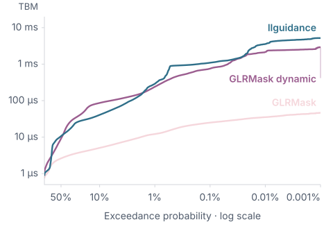

# GLRMask

<!-- Generated by scripts/sync-guide.py from docs/content. Do not edit this output. -->

GLRMask is a grammar-constrained decoding library for high-throughput LLM serving. It is optimized for fast mask computation with extremely low tail latency, even for complex grammars.

GLRMask supports general context-free grammars, including ambiguous ones. It accepts JSON Schema, Lark and [GLRM](https://github.com/IsaacBreen/glrmask/blob/main/docs/glrm-format.md).

[Website](https://glrmask.com) · [Paper](https://doi.org/10.5281/zenodo.23273556)

## Benchmarks

### JSON Schema

Time between masks. Lower is better.

<p align="center">
<picture>
  <source media="(prefers-color-scheme: dark)" srcset="docs/assets/benchmark-tbm-json-2026-10-14-dark.svg">
  
</picture>
</p>

**TBM (µs)**

| Statistic | Static | Dynamic | llguidance |
|---|---:|---:|---:|
| Mean | 3.0 | 31.5 | 25.9 |
| p50 | 2.6 | 9.1 | 10.6 |
| p90 | 5.1 | 86.4 | 40.7 |
| p99 | 12.2 | 239.5 | 289.9 |
| p99.9 | 24.9 | 754.2 | 1,092.6 |
| Max | 283.1 | 3,647.8 | 6,931.5 |

**Time to first mask (ms)**

| Statistic | Static | Dynamic | llguidance |
|---|---:|---:|---:|
| Mean | 33.7 | 3.9 | 1.2 |
| p50 | 12.6 | 2.3 | 0.8 |
| p90 | 78.9 | 6.5 | 1.8 |
| p99 | 302.3 | 35.9 | 11.1 |
| p99.9 | 854.3 | 88.8 | 17.9 |
| Max | 1,293.4 | 274.6 | 231.0 |

Static measured the parser DWA implementation; Dynamic measured token-trie traversal. These are historical engine measurements, not performance guarantees for the current presets.

14 October 2026 · 11,277 complete valid trajectories accepted by all measured engines · 1,734,930 TBM positions per engine · 8,326 common-built cases for TTFM. One unpinned native wall-clock timing run on AWS c8i.8xlarge (Intel Xeon 6975P-C, 32 available CPUs). Vocabulary preparation is excluded.

### JavaScript

Time between masks. Lower is better.

<p align="center">
<picture>
  <source media="(prefers-color-scheme: dark)" srcset="docs/assets/benchmark-tbm-javascript-2026-10-14-dark.svg?v=5274bdb45744">
  
</picture>
</p>

**TBM (µs)**

| Statistic | Static | Dynamic | llguidance |
|---|---:|---:|---:|
| Mean | 16.9 | 1,392.4 | 1,052.2 |
| p50 | 18.2 | 145.5 | 856.6 |
| p90 | 30.4 | 3,626.1 | 2,521.7 |
| p99 | 47.9 | 4,091.7 | 3,097.0 |
| p99.9 | 71.1 | 4,656.9 | 3,597.1 |
| Max | 77.4 | 5,517.4 | 3,867.9 |

**Time to first mask (ms)**

| Statistic | Static | Dynamic | llguidance |
|---|---:|---:|---:|
| Mean | 5,089.4 | 113.3 | 8.0 |
| p50 | 5,099.6 | 113.0 | 8.0 |
| p90 | 5,152.7 | 116.9 | 8.1 |
| p99 | 5,223.0 | 120.7 | 8.2 |
| p99.9 | 5,225.9 | 121.7 | 8.2 |
| Max | 5,226.2 | 121.8 | 8.2 |

Static measured the parser DWA implementation; Dynamic measured token-trie traversal. These are historical engine measurements, not performance guarantees for the current presets.

14 October 2026 · 28 complete valid trajectories accepted by all measured engines · 3,805 TBM positions per engine · 55 common-built cases for TTFM. One unpinned native wall-clock timing run on AWS c8i.8xlarge (Intel Xeon 6975P-C, 32 available CPUs). Vocabulary preparation is excluded.

#### Dynamic mode

GLRMask’s dynamic mode trades some mask-generation speed for lower cold-start latency. It is heavily based on [llguidance](https://github.com/guidance-ai/llguidance).

<p align="center">
<picture>
  <source media="(prefers-color-scheme: dark)" srcset="docs/assets/benchmark-tbm-json-dynamic-2026-10-14-dark.svg">
  
</picture>
</p>

[Explore Dynamic JSON results](https://glrmask.com/?dataset=json&mode=dynamic#benchmarks).

There was no CPU pinning or SMT sibling reservation, and checkpoint publication overlapped the benchmark. Saved telemetry cannot isolate scheduling effects; latency stabilization is not certified. Successful builds do not establish semantic correctness. All 9,558 JSON schemas were attempted: build errors are Dynamic 232, Static 233 and llguidance 1,226. Incorrect examples are 460 for each GLRMask mode and 100 for llguidance; runtime-error examples are 0 and 6 respectively. JavaScript attempts all 55 fixtures: all builds succeed, with 1 incorrect example per GLRMask mode and 4 for llguidance. Headline TBM excludes incomplete or nonaccepted valid trajectories; all outcomes remain in the raw records. This finite corpus does not establish full-language equivalence or whole-corpus dominance.

[Native AWS benchmark details](https://github.com/IsaacBreen/glrmask/blob/main/docs/benchmark-aws-2026-10-14.md). Historical [October 8 Mac JSON](https://github.com/IsaacBreen/glrmask/blob/main/docs/benchmark-cfa-2026-10-08.md) and [October 9 Mac JavaScript](https://github.com/IsaacBreen/glrmask/blob/main/docs/benchmark-javascript-2026-10-09.md) reports are retained with their original measurement protocols. These are source builds, not measurements of the published packages.

## Getting started

### Installation

#### Python

```bash
python -m pip install glrmask
```

For the release candidate: `pip install --pre glrmask` or `pip install glrmask==1.0.0rc1`.

#### Rust

```bash
cargo add glrmask
```

For the release candidate: `cargo add glrmask@1.0.0-rc.1`.

#### Native C++ and Node.js

Native bindings are available for C++ and JavaScript/TypeScript on Node.js. The [C++ guide and C API](https://glrmask.com/api/cpp/) and [JavaScript and TypeScript guide](https://glrmask.com/api/javascript/) cover source builds, platform artifacts, ownership, composition, and the complete supported API. The Node.js addon does not run in browsers.

### Usage

GLRMask has four core types:

- `Grammar`
- `Module`: a partially compiled grammar.
- `Constraint`: a compiled grammar, ready to use.
- `ConstraintState`: the state of one generated sequence.

### Python quickstart

```python
import numpy as np
import glrmask

grammar = glrmask.Grammar.from_json_schema({
    "type": "object",
    "properties": {"color": {"enum": ["red", "green", "blue"]}},
    "required": ["color"],
    "additionalProperties": False,
})

# One token per byte, plus EOS. With a real model, build this from its tokenizer.
vocab = glrmask.Vocab({i: bytes([i]) for i in range(256)})
EOS = 256

state = grammar.compile(vocab).start()
rng = np.random.default_rng(0)
output = []
while True:
    logits = rng.standard_normal(257)  # stand-in for your model
    allowed = np.zeros(257, dtype=bool)
    m = state.mask()
    # NumPy boilerplate: unpack the bitmask into booleans to index the logits.
    allowed[:state.mask_bit_len] = np.unpackbits(m.astype('<u4').view(np.uint8), bitorder='little')[:state.mask_bit_len].astype(bool)
    allowed[EOS] = state.is_accepting()
    if not allowed.any():
        raise RuntimeError("no allowed token and cannot stop")
    token = int(np.argmax(np.where(allowed, logits, -np.inf)))
    if token == EOS:
        break
    if not state.commit_token(token):
        raise RuntimeError("allowed token rejected")
    output.append(token)

if not state.is_accepting():
    raise RuntimeError("incomplete output")
print(bytes(output).decode())  # e.g. {"color": "blue"}
```

### Rust quickstart

```rust
use glrmask::{Grammar, Vocab};

fn main() -> glrmask::Result<()> {
    let grammar = Grammar::from_json_schema(r#"{
        "type": "object",
        "properties": {"color": {"enum": ["red", "green", "blue"]}},
        "required": ["color"],
        "additionalProperties": false
    }"#)?;

    // One token per byte, plus EOS. With a real model, build this from its tokenizer.
    let vocab = Vocab::new((0..256u32).map(|b| (b, vec![b as u8])))?;
    const EOS: u32 = 256;

    let mut state = grammar.compile(&vocab)?.start();
    let mut output = Vec::new();
    loop {
        let logits = model(&output); // stand-in for your model
        let mask = state.mask();
        let allowed = |t: u32| match t {
            EOS => state.is_accepting(),
            t => mask[t as usize / 32] >> (t % 32) & 1 == 1,
        };
        let token = (0..=EOS)
            .filter(|&t| allowed(t))
            .max_by(|&a, &b| logits[a as usize].total_cmp(&logits[b as usize]))
            .expect("no allowed token and cannot stop");
        if token == EOS {
            break;
        }
        assert!(state.commit_token(token), "allowed token rejected");
        output.push(token as u8);
    }
    assert!(state.is_accepting(), "incomplete output");
    println!("{}", String::from_utf8_lossy(&output)); // e.g. {"color": "blue"}
    Ok(())
}

fn model(output: &[u8]) -> Vec<f32> {
    (0..257).map(|t| ((t * 7919 + output.len() * 104_729) % 1000) as f32).collect()
}
```

### Composing grammars

A grammar can declare externs, named slots that you bind later: `extern grammar NAME` takes a grammar, and
`extern token NAME` takes token IDs. Each grammar keeps its own rules, including the whitespace it ignores. A `Module`
holds a grammar, its bindings and any precompiled work, so parts you reuse, such as each tool's schema, are compiled once:

```python
import glrmask

vocab = glrmask.Vocab({i: bytes([i]) for i in range(256)})
weather = glrmask.Module(glrmask.Grammar.from_json_schema(
    '{"type": "object", "properties": {"city": {"type": "string"}},'
    ' "required": ["city"], "additionalProperties": false}'))
weather.precompile(vocab)

call = glrmask.Module(glrmask.Grammar.from_glrm('''
    extern grammar ARGS
    start call
    nt call = "<weather>" ARGS "</weather>"
'''))
call.bind("ARGS", weather)
state = call.compile(vocab).start()
assert state.commit_bytes(b'<weather>{"city": "Perth"}</weather>')
assert state.is_accepting()
```

`Expr.choice`, `Expr.sequence` and `Expr.literal` combine grammars without writing a new one.

### Mask strategies

`MaskStrategy` controls how the constraint is compiled: `AUTO` (the default; currently `FAST_MASKS`), `FAST_COMPILE` (faster compilation, slower masks),
or `FAST_MASKS` (faster masks, slower compilation). These are preferences, not speed guarantees.

The [full guide](GUIDE.md) covers generation, composition, token sets, strategies and errors.

## How it works

GLRMask maintains a GLR parser state for the generated prefix. A precomputed deterministic weighted automaton computes the next-token mask by reading each parser stack, intersecting Boolean vocabulary masks along each traversal and unioning alternative paths.

See [How it works](https://glrmask.com/implementation/) for the explanation and diagrams.

## License

Licensed under either the MIT License or the Apache License, Version 2.0, at your option.
