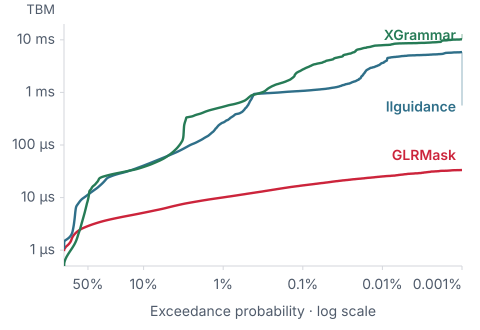

# GLRMask

<!-- Generated by scripts/sync-guide.py from docs/content. Do not edit this output. -->

GLRMask is a grammar-constrained decoding library for high-throughput LLM serving. It is optimized for fast mask computation with low tail latency, even for complex grammars.

GLRMask supports general context-free grammars, including ambiguous ones. It accepts JSON Schema, Lark and [GLRM](https://github.com/IsaacBreen/glrmask/blob/main/docs/glrm-format.md).

[Website](https://glrmask.com) · [Paper](https://doi.org/10.5281/zenodo.23273556)

## Benchmarks

### JSON Schema

Time between masks. Lower is better.

<p align="center">
<picture>
  <source media="(prefers-color-scheme: dark)" srcset="docs/assets/benchmark-tbm-json-2026-10-19-dark.svg">
  
</picture>
</p>

**Time between masks (µs)**

| Statistic | GLRMask | llguidance | XGrammar |
|---|---:|---:|---:|
| mean | 3.2 | 25.3 | 35.9 |
| p50 | 2.9 | 11.4 | 9.1 |
| p90 | 5.1 | 40.6 | 38.2 |
| p99 | 10.1 | 267.8 | 534.0 |
| p99.9 | 17.0 | 1,070.7 | 2,736.8 |
| p99.99 | 25.2 | 3,627.2 | 7,901.3 |
| max | 43.8 | 8,276.3 | 12,660.3 |

**Time to first mask (ms)**

| Statistic | GLRMask | llguidance | XGrammar |
|---|---:|---:|---:|
| mean | 37.3 | 1.3 | 84.5 |
| p50 | 16.8 | 0.9 | 44.3 |
| p90 | 75.0 | 2.1 | 203.2 |
| p99 | 306.4 | 13.3 | 834.3 |
| max | 1,350.1 | 48.6 | 4,066.2 |

### JavaScript

Time between masks. Lower is better.

<p align="center">
<picture>
  <source media="(prefers-color-scheme: dark)" srcset="docs/assets/benchmark-tbm-javascript-2026-10-19-dark.svg?v=06169e60e086">
  
</picture>
</p>

**Time between masks (µs)**

| Statistic | GLRMask | llguidance | XGrammar |
|---|---:|---:|---:|
| mean | 17.2 | 1,152.4 | 116,561.8 |
| p50 | 18.4 | 938.6 | 47,894.1 |
| p90 | 30.1 | 2,661.0 | 621,935.7 |
| p99 | 46.7 | 3,389.5 | 679,617.9 |
| p99.9 | 63.6 | 3,761.8 | 805,342.2 |
| p99.99 | 69.3 | 3,819.2 | 825,890.1 |
| max | 69.6 | 3,825.7 | 826,881.4 |

**Time to first mask (ms)**

| Statistic | GLRMask | llguidance | XGrammar |
|---|---:|---:|---:|
| JavaScript | 5,593.7 | 8.9 | 4,175.5 |

19 October 2026 campaign · AWS c7i.16xlarge, Llama 3.1 8B Instruct vocabulary; GLRMask 3d65c7a, llguidance 1.9.1, XGrammar 0.2.8; matched valid trajectories (JSON: 1,570,228 positions; JavaScript: 2,370); JavaScript TTFM is a single cold observation. [Measurement details](https://glrmask.com/#benchmarks).

## Getting started

### Installation

#### Python

```bash
python -m pip install glrmask
```

#### Rust

```bash
cargo add glrmask
```

#### Native C++ and Node.js

Native bindings are available for C++ and JavaScript/TypeScript on Node.js. The [C++ guide and C API](https://glrmask.com/api/cpp/) and [JavaScript and TypeScript guide](https://glrmask.com/api/javascript/) cover source builds, platform artifacts, ownership, composition, and the complete supported API. The Node.js addon does not run in browsers.

### Usage

GLRMask has four core types:

- `Grammar`: a grammar, written as source text or built from an expression.
- `Constraint`: a compiled grammar, ready to use.
- `ConstraintState`: the state of one generated sequence.
- `Module`: a partially compiled grammar ([see below](#composing-grammars)).

In the quickstart, supply the tokenizer's exact token bytes and the model's EOS ID. The model produces logits; the sampling routine must apply the packed mask and permit EOS only when the state is accepting.

### Python quickstart

```python
grammar = Grammar.from_json_schema({
    "type": "object",
    "properties": {
        "color": {
            "enum": ["red", "green", "blue"]
        }
    },
    "required": ["color"],
    "additionalProperties": False,
})

# Token ID -> exact bytes from tokenizer
vocab = Vocab(token_bytes)
state = grammar.compile(vocab).start()

output = []
while True:
    logits = model(output)
    mask = state.mask()
    token = sample(
        logits, mask, state.is_accepting()
    )
    if token == EOS:
        break
    if not state.commit_token(token):
        raise RuntimeError("Rejected token")
    output.append(token)
```

### Rust quickstart

```rust
let grammar = Grammar::from_json_schema(
    r#"{
        "type": "object",
        "properties": {
            "color": {
                "enum": [
                    "red", "green", "blue"
                ]
            }
        },
        "required": ["color"],
        "additionalProperties": false
    }"#,
)?;

// Token ID -> exact bytes from tokenizer
let vocab = Vocab::new(token_bytes)?;
let constraint = grammar.compile(&vocab)?;
let mut state = constraint.start();

let mut output = Vec::new();
loop {
    let logits = model(&output);
    let mask = state.mask();
    let token = sample(
        &logits, &mask, state.is_accepting()
    );
    if token == EOS { break; }
    assert!(state.commit_token(token));
    output.push(token);
}
```

## Composing grammars

In a typical serving setup, a grammar constraint is one main grammar with smaller grammars nested inside it, some of which, like tool schemas, change from request to request. GLRMask is built to make this kind of composition cheap. Like modules in a program, grammars can be written and compiled as separate parts and combined later.

A server compiles its main grammar once as a `Module` with named externs. Each tool's schema is compiled on its own, in parallel or on another machine. Per request, GLRMask composes the main grammar with the compiled schemas by filling in the externs. Resolving the interactions between the grammars requires some extra *boundary* work. However, since this work is usually small compared with compiling the grammars themselves, composition remains cheap even when the grammars are large.

```python
# Token ID -> exact bytes from tokenizer
vocab = Vocab(token_bytes)

weather = Grammar.from_json_schema({
    "type": "object",
    "properties": {
        "city": {"type": "string"}
    },
    "required": ["city"],
    "additionalProperties": False,
}).compile(vocab)

parent = Grammar.from_glrm('''
    extern grammar ARGS
    start call
    nt call = "<weather>" ARGS
              "</weather>"
''')
call = Module(parent)
call.bind("ARGS", weather)
constraint = call.compile(vocab)
```

```rust
// Token ID -> exact bytes from tokenizer
let vocab = Vocab::new(token_bytes)?;

let weather = Grammar::from_json_schema(
    r#"{
        "type": "object",
        "properties": {
            "city": {"type": "string"}
        },
        "required": ["city"],
        "additionalProperties": false
    }"#,
)?.compile(&vocab)?;

let parent = Grammar::from_glrm(r#"
    extern grammar ARGS
    start call
    nt call = "<weather>" ARGS
              "</weather>"
"#)?;
let mut call = Module::new(&parent);
call.bind("ARGS", &weather)?;
let constraint = call.compile(&vocab)?;
```

See the [guide](https://github.com/IsaacBreen/glrmask/blob/v1.0.0-rc.1/GUIDE.md#composing-grammars) for the API.

## How it works

GLRMask maintains a GLR parser state for the generated prefix. A precomputed deterministic weighted automaton computes the next-token mask by reading each parser stack, intersecting Boolean vocabulary masks along each traversal and unioning alternative paths.

See [How it works](https://glrmask.com/implementation/) for the explanation and diagrams.

## License

Licensed under either the MIT License or the Apache License, Version 2.0, at your option.
