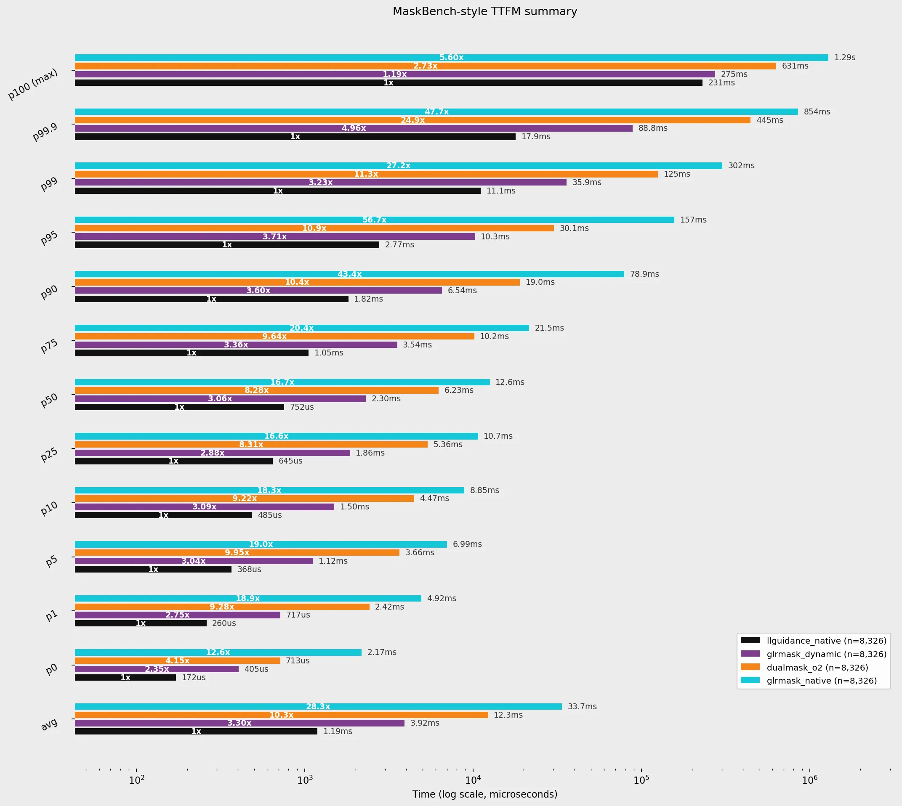
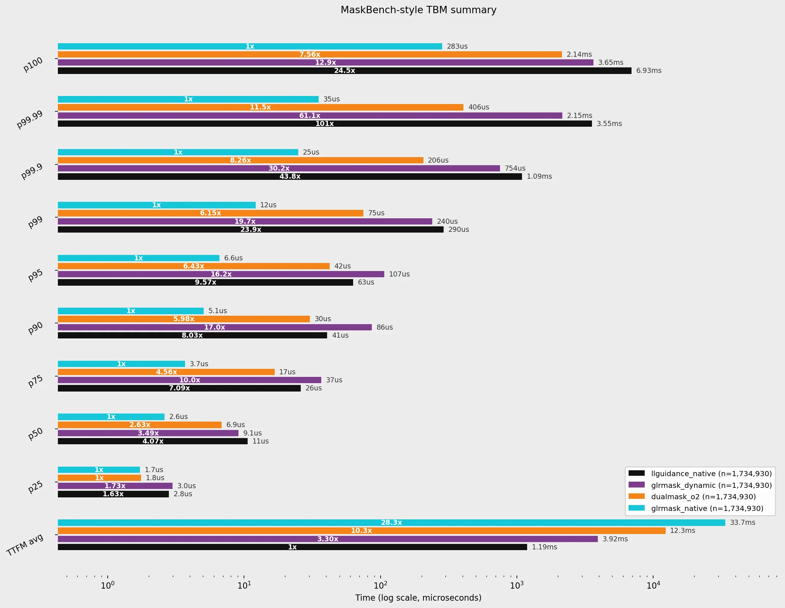
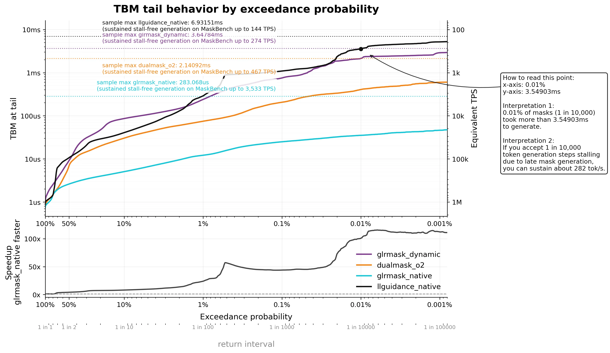
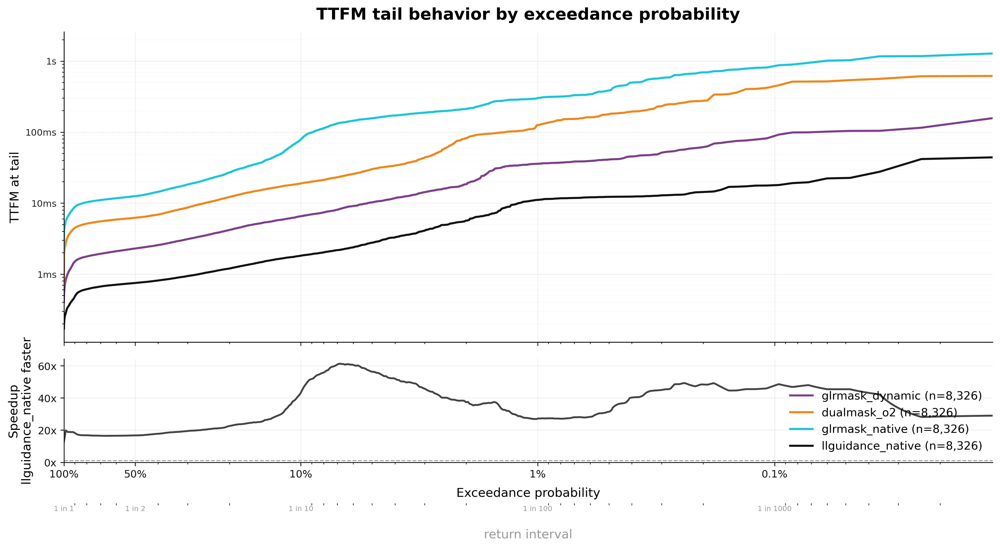
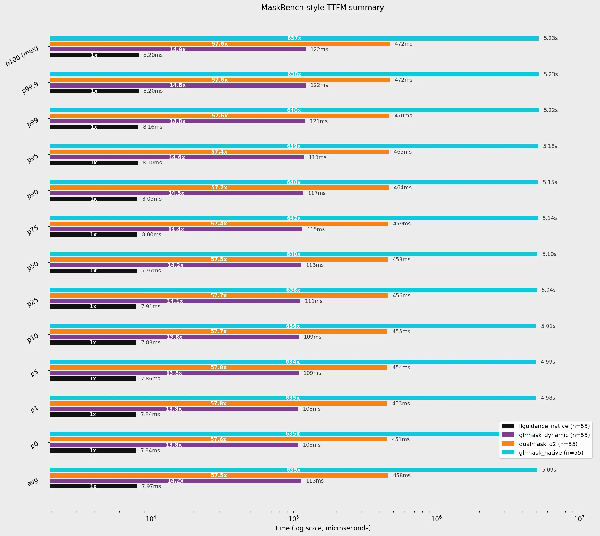
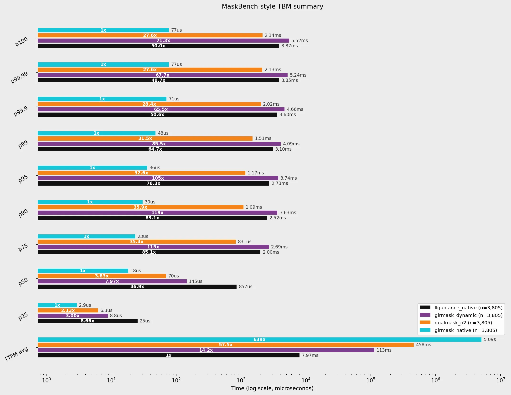
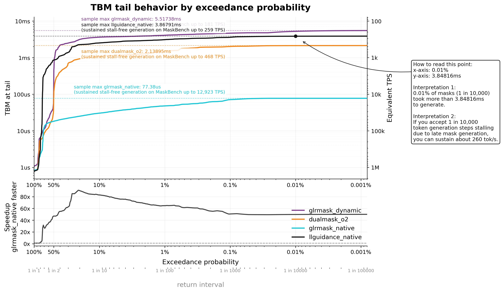
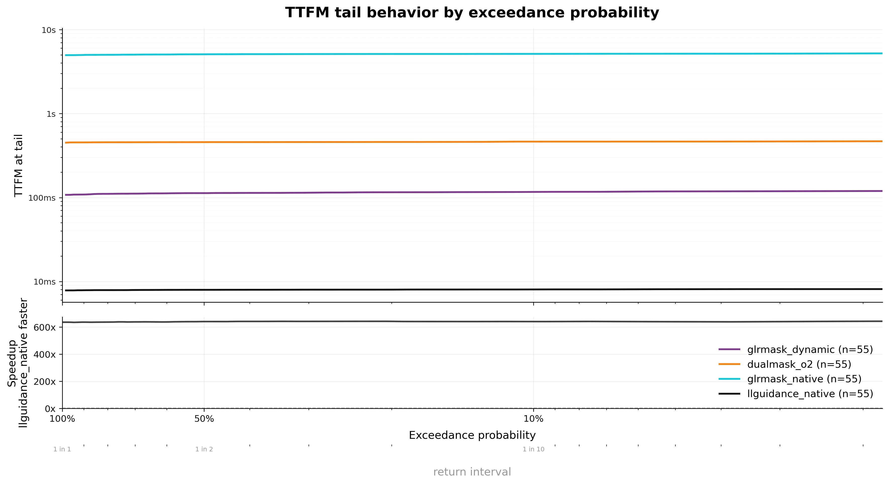

# Native AWS benchmark — 14 October 2026

The retained campaign measured four engines once on AWS c8i.8xlarge: Linux x86_64, Intel Xeon 6975P-C, with 32 available logical CPUs. GLRMask revision `5657d277854d1a3d1bf8ea760bae4d50a7b0167e` and llguidance revision `f0971424ec072d3e4d4196bcc7f31a2f60527df9` were frozen before timing. These measurements describe those source builds, rather than the latest repository revision or published packages.

The vocabulary is Llama 3.1 8B Instruct, with 128,256 entries and tokenizer revision `a2856192dd7c25b842431f39c179a6c2c2f627d1`. Archive SHA-256: `0267240e2b842ccbe4408d7144d1ccb4898b310468798488f630fed4df577ba7`.

## Populations and timing

The current `make jsb` invokes the native Rust reporter. JSON headline TBM uses 11,277 identical complete valid trajectories accepted by every engine, with 1,734,930 positions each. TTFM uses 8,326 common-built schemas. All 9,558 official schemas were attempted, and failures are retained separately.

JavaScript attempts 55 fixtures: 31 capability cases and 24 negative cases. Its headline TBM uses 28 complete valid trajectories accepted by every engine, with 3,805 positions each. TTFM contains 55 repeated cold-build observations of one practical-JavaScript grammar. These are not 55 different grammar samples. Only 51 fixtures are correctly evaluated by every engine; successful builds do not establish semantic correctness or full ECMAScript support.

TBM is native wall time from committing the previously allowed token through the next ready mask. TTFM is wall time from schema-dependent construction start through first ready mask. Vocabulary preparation is excluded. EOS handling is included inside native ready-mask timing; other model controls are excluded unless explicitly constrained as exact IDs. No external mask postfilter is used.

One problem runs at a time, with a 60-second build limit and 120-second runtime limit. A synthetic global warmup is enabled; real schemas are not warmed up. The run has one timing pass. Statistics use linear-interpolated percentiles and arithmetic means. README and interactive tail views sample the empirical inverse survival function with straight segments, without numerical smoothing or extrapolation.

## Timing qualification

The run did not pin CPUs, isolate cores or reserve SMT siblings. Checkpoint staging, verification and publication overlapped the living benchmark child. Retained telemetry cannot separate intrinsic work from scheduling, steal-time or frequency effects. Latency isolation and stabilization are not certified.

Static common-build TTFM maximum is 1.293389335 s, almost entirely construction (1.293215283 s). The all-supported Static maximum is 2.373731268 s, excluded from the common-build cohort because llguidance fails to build that schema. Static headline TBM maximum is 283.068 µs. Its token-specific hotspot recurs in the same-source October 11 Linux run; the cause remains unresolved. Cross-machine timing differences do not establish causal code regressions.

The initial A–D delivery used the legacy Python shared-prefix population. It was corrected before this publication. The figures below use the native valid-common export and match every native summary quantile. No timing workload was rerun during recovery or plot correction.

## JSON native figures

A and D summarize 8,326 common-built schemas for TTFM. B and C summarize the complete valid-common TBM population. Historical A–D layouts differ from the native reporter's SVG layouts; their populations and numerical values agree. Log-scale tail views cannot display zero-percent exceedance: use A/B and native quantiles for exact maxima.

## Practical-JavaScript native figures

These use the 55 common-built cases for TTFM and the 28 common complete valid trajectories for TBM. The timing qualifications and practical-JavaScript scope above apply.

## Full outcomes

| Engine | JSON build OK | JSON build errors | JSON incorrect examples | JSON runtime-error examples | JS build OK | JS incorrect examples |
|---|---:|---:|---:|---:|---:|---:|
| Dynamic | 9,326 | 232 | 460 | 0 | 55 | 1 |
| Balanced | 9,326 | 232 | 460 | 0 | 55 | 1 |
| Static | 9,325 | 233 | 460 | 0 | 55 | 1 |
| llguidance | 8,332 | 1,226 | 100 | 6 | 55 | 4 |

All 220 JavaScript builds succeed and no runtime-error examples occur, but semantic disagreements remain. There are 38,232 JSON records, including 1,923 build errors; together with JavaScript there are 38,452 records. Build success and native runtime qualification are distinct from corpus correctness. Selected-cohort performance does not establish whole-corpus dominance or full-language equivalence.

The [JSON snapshot](benchmarks/json-schema-2026-10-14.json) and [JavaScript snapshot](benchmarks/javascript-2026-10-14.json) retain source identities, outcome counts, mode statistics and measured tail samples. Historical Mac reports, snapshots and assets remain unchanged with their separate hardware, clocks and repetition policies.
