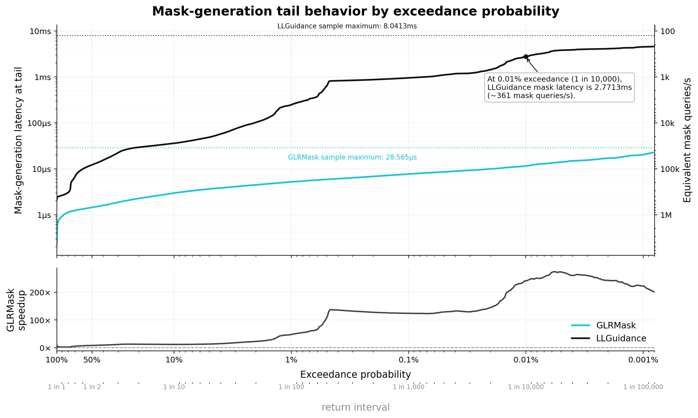
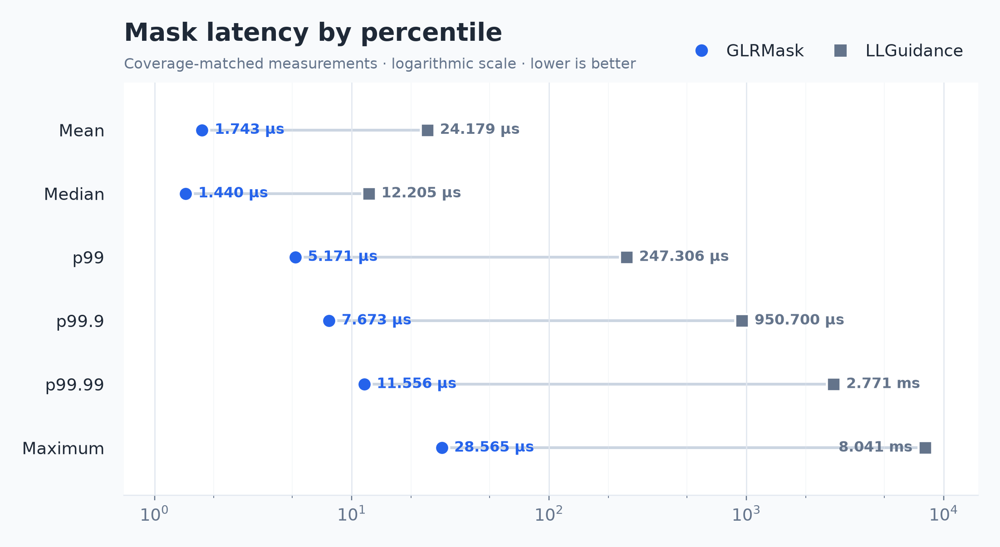
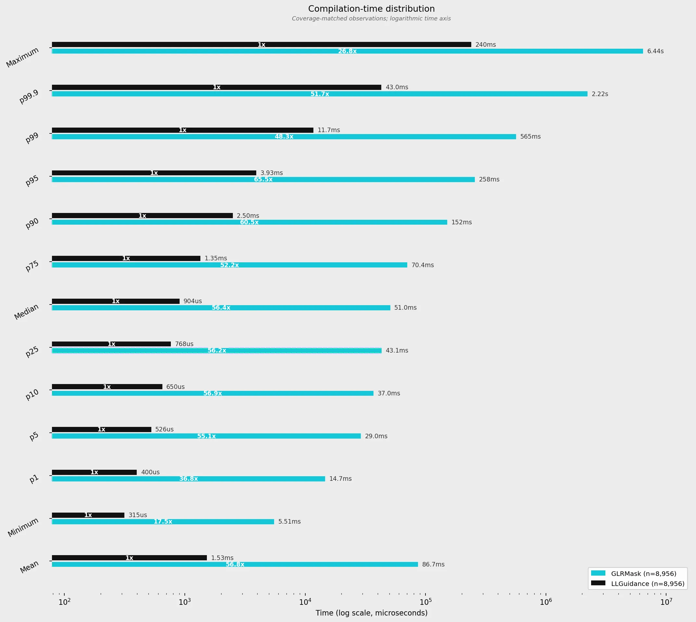

# GLRMask

GLRMask is a grammar-constrained generation library for high-throughput LLM decoding. It is optimized for extremely low next-token mask latency across the distribution, even for complex grammars.

## Performance

Measured with MaskBench on the JSONSchemaBench corpus, using the Llama 3 vocabulary on an Intel Core i7-13620H under Ubuntu 24.04/WSL2.

> **Preliminary:** these timings are not yet accurate and should not be relied on.

### Mask-generation latency

  <picture>
    <source media="(prefers-color-scheme: dark)" srcset="../assets/benchmark-mask-tail-2026-07-16-dark.webp">
    <source media="(prefers-color-scheme: light)" srcset="../assets/benchmark-mask-tail-2026-07-16.webp">
    
  </picture>

  <picture>
    <source media="(prefers-color-scheme: dark)" srcset="../assets/benchmark-mask-summary-2026-07-16-dark.webp">
    <source media="(prefers-color-scheme: light)" srcset="../assets/benchmark-mask-summary-2026-07-16.webp">
    
  </picture>

### Compilation time

  <picture>
    <source media="(prefers-color-scheme: dark)" srcset="../assets/benchmark-compilation-summary-2026-07-16-dark.webp">
    <source media="(prefers-color-scheme: light)" srcset="../assets/benchmark-compilation-summary-2026-07-16.webp">
    
  </picture>

See the [full benchmark report](../benchmark-full-corpus-2026-07-16.md) for methodology.

---

[Compare the three benchmark layouts](README.md)
