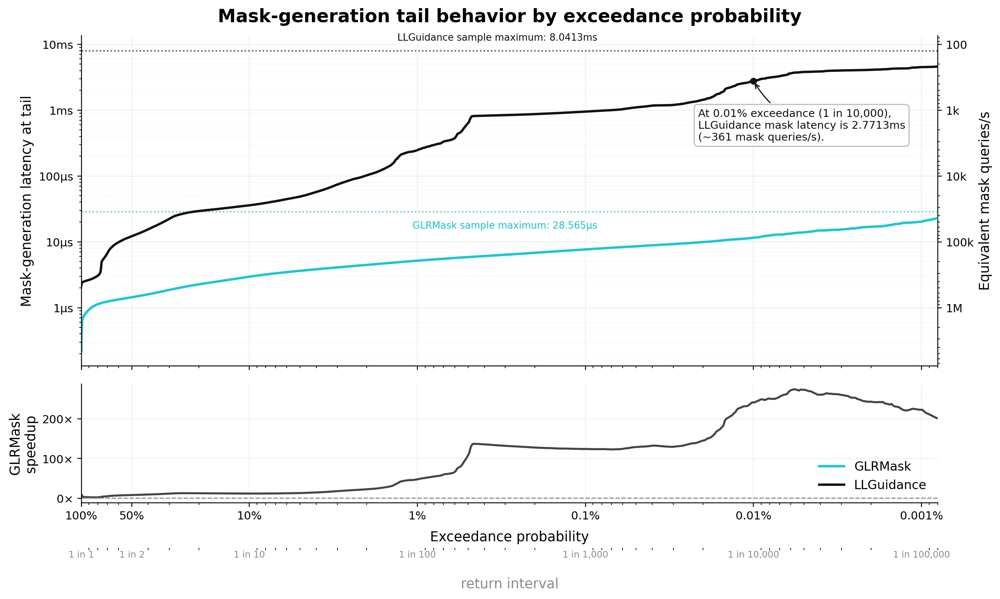

# GLRMask

GLRMask is a grammar-constrained generation library for high-throughput LLM decoding. It is optimized for extremely low next-token mask latency across the distribution, even for complex grammars.

## Performance

Measured with MaskBench on the JSONSchemaBench corpus, using the Llama 3 vocabulary on an Intel Core i7-13620H under Ubuntu 24.04/WSL2.

> **Preliminary:** these timings are not yet accurate and should not be relied on.

### Mask-generation latency

  <picture>
    <source media="(prefers-color-scheme: dark)" srcset="../assets/benchmark-mask-tail-2026-07-16-dark.webp">
    <source media="(prefers-color-scheme: light)" srcset="../assets/benchmark-mask-tail-2026-07-16.webp">
    
  </picture>

| Latency | GLRMask | LLGuidance |
|---|---:|---:|
| Mean | **1.743 µs** | 24.179 µs |
| Median | **1.440 µs** | 12.205 µs |
| p99 | **5.171 µs** | 247.306 µs |
| p99.9 | **7.673 µs** | 950.700 µs |
| p99.99 | **11.556 µs** | 2,771.304 µs |
| Maximum | **28.565 µs** | 8,041.301 µs |

### Compilation time

| Compilation time | GLRMask | LLGuidance |
|---|---:|---:|
| Mean | 86.698 ms | **1.527 ms** |
| Median | 50.963 ms | **0.904 ms** |
| p99 | 565.257 ms | **11.711 ms** |
| p99.9 | 2,221.152 ms | **42.989 ms** |
| Maximum | 6,440.287 ms | **239.964 ms** |

See the [full benchmark report](../benchmark-full-corpus-2026-07-16.md) for methodology.

---

[Compare the three benchmark layouts](README.md)
